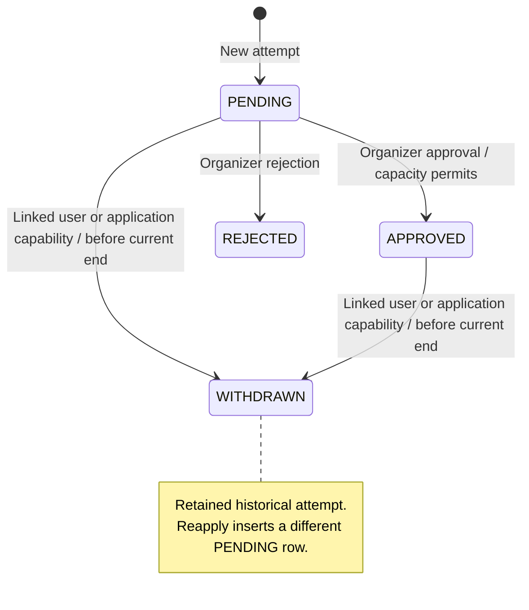

# Event Flow Domain Model

This is the authoritative description of the implemented domain semantics and
invariants. [PRODUCT.md](PRODUCT.md) describes user-facing capabilities; exact
storage definitions are in [prisma/schema.prisma](prisma/schema.prisma). Code
references below identify enforcement points. An intentional change to an
invariant must update this document with its implementation.

## 1. Identity

Google uses Better Auth's native provider, authorization-code callback, state,
PKCE, provider identity and account-linking endpoints. `User` remains the domain
identity; the existing Account and User.image fields hold OAuth data.
PostgreSQL enforces unique `(providerId, accountId)` through
`account_providerId_accountId_key`. This is the final authority for concurrent
OAuth callbacks, including attempts in different sessions. A conflicting insert
is rejected; it never creates a second provider identity. No application locks or
custom OAuth synchronization are used. The current baseline includes this index.
Better Auth 1.7.6 surfaces a losing manual-link insert as HTTP 500; retrying the
native link resolves the existing account. The uniqueness guarantee does not
require both racing requests to report success.
`disableImplicitLinking` prevents email-only OAuth account merging, including
verified-email collisions. Explicit linking requires the verified local session,
the initiating UI's User identity, and the same verified Google email. Better Auth
rejects provider identities bound to another User. The native validation hook
rechecks the current verified session against the state-bound linking User at
callback time, rejecting sign-out, expiry and account switches before validation.
Native origin/state/redirect checks remain enabled; app callbacks use safe local
paths. No custom OAuth protocol or email-based ownership resolver is used.

Only Google Account rows may be unlinked, and only if a credential Account with a
nonempty password remains for the verified User. Native fresh-session and last-account
guards also apply. Credential unlink requests are rejected, so competing unlink
requests cannot remove each other's remaining method. No password deletion or
additional providers are enabled. Linking/unlinking does not grant OrganizerProfile,
change RBAC, or revoke unrelated sessions. A session revocation racing after a
successful authorization check has the same in-flight request limitation as other
session-authorized mutations.

Native profile synchronization on explicit linking is narrowed by the User update
hook to the Google image only; name is excluded from the adapter update. Existing
email, verification, preferences and domain data are not overwritten. New Google
accounts receive the native profile name and image. Images load directly in the
browser with no-referrer and fall back to initials on load failure; no image proxy,
upload or storage is added. The image URL is retained after disconnection.

Email verification uses a single current, one-use delivery token per User in
the existing Verification table, addressed by the exact namespaced identifier
`event-flow:email-verification:<userId>`, with an independent row ID.
Only a SHA-256 digest of the delivery token is stored. A random nonce distinguishes
deliveries even when Better Auth issues identical JWTs within one second.
Delivery holds a User row lock and deletes/recreates this exact slot
transactionally; SMTP failure rolls back the replacement.
Transport acceptance and database commit are not
a distributed transaction: a commit failure after acceptance can leave the newly
delivered link unusable, requiring resend.

The `/verify-email` before hook atomically deletes the matching, unexpired digest
before passing the original JWT to Better Auth for signature/expiry validation,
email confirmation, and automatic sign-in. Concurrent clicks have one winner;
revoked, consumed, expired, and legacy untracked links fail closed. A failure
after consumption requires resend. An already accepted verification request may
finish while a subsequent resend is in progress; resend cannot undo that request.
The one-hour expiry and contextual return destination remain unchanged.

Source: [verification delivery and consumption](lib/email-verification.ts),
[Better Auth hooks](lib/auth.ts).

Password recovery uses Better Auth's native `requestPasswordReset`,
`sendResetPassword` callback and `resetPassword` endpoint. It creates no custom
reset token or authentication system. Native cryptographic 24-character tokens
expire after 1800 seconds; Better Auth hashes only `reset-password:` identifiers
in Verification and atomically consumes them with expiry validation. Other
verification namespaces and the existing email-verification contract are unchanged.
Each link is single-use; requesting another link does not extend old links.

Recovery is restricted to existing credential Accounts with a nonempty password.
Absent and OAuth-only identities receive the same native neutral response without
issuing a token or sending email. Reset rechecks credential eligibility; an Account
create hook also rejects native reset attempts to create a credential Account.
Google linking, last-login-method rules and email verification status are unchanged.
The native 10–128 password policy remains authoritative. Successful reset deletes
all existing User sessions through `revokeSessionsOnPasswordReset`; no session is
created. With this installed Better Auth version, token consumption, password update
and session deletion are separate operations. A failure after token consumption
requires a new link; success is returned only after session deletion completes.

HTTP recovery requests require an exact configured application Origin, including
requests without cookies. Native throttling is enabled in all environments: one
request-password-reset and five reset-password requests per client-IP bucket in
60 seconds. It uses the existing process-memory store, resets on restart, and relies
on the deployment's trusted forwarding of client IPs; it is not a distributed or
per-account abuse quota. Native origin and cookie security remain enabled elsewhere.

Reset mail uses a canonical `/reset-password#<token>` link. Recovery validates a
strict email/optional fixed `/reset-password` request body before account lookup;
unknown fields, query parameters and other redirect destinations are rejected
identically for every identity. The browser immediately replaces the URL with `/reset-password`
and retains the token in memory only. Submission sends it in a POST JSON body to
Better Auth. Native path/query-token reset entry points are rejected. Recovery pages
use no-referrer, no-store and noindex headers; no analytics, logs or ordinary API
responses receive reset tokens or password credentials. The native token checker
runs on submission and returns a clear invalid/expired/used-link state.

Recovery mail is sent from `Event Flow <notifications@eventflow.today>` using the
existing shared localized template and SMTP/Resend transports. Request UI locale is
resolved with the same policy as verification. Next.js `after` starts delivery after
the neutral response so provider latency/failure does not disclose account existence.
The callback schedules one delivery for the one native token; it never reissues a
token. A sanitized fixed failure message is logged, without recipient or error data.
There is no automatic auth-mail retry. The Event Email Outbox requires Communication
and Event context and is deliberately not used for short-lived authentication mail.
A process failure before delivery may require another request. SMTP/Resend settings,
provider pacing, local Mailpit and Event outbox retry behavior remain unchanged.

Sources: [Better Auth configuration](lib/auth.ts),
[recovery email](lib/password-reset.ts),
[reset form](features/auth/components/reset-password-form.tsx).

`User` is the single Event Flow identity. `OrganizerProfile` is an optional,
one-per-User organizer capability. There is no GuestProfile,
AttendeeProfile, User.role, or isOrganizer domain field/entity.

Registration, sign-in, GET `/dashboard`, and GET `/onboarding/organizer` do not
create profiles. The verified-user `becomeOrganizer` action is the only current
activation path; `ensureOrganizerProfile` is idempotent through unique userId and
skipDuplicates. `/account` belongs to the User; `/dashboard` requires a verified User and
shows owned-event metrics only for an activated organizer, with assignment navigation
for Staff. Creation still requires OrganizerProfile. REQUIRED registration requires
a verified User, not a profile.

Sources: [activation](app/(application)/onboarding/organizer/actions.ts),
[organizer guard](features/organizer/server/require-organizer.ts),
[session guards](lib/session.ts).

## 2. Event workspace

`Event` and its `RegistrationForm`, fields, and options are mutable organizer
workspace. Manual Event creation also creates an empty registration form; template creation
atomically initializes it from validated configuration (section 31). Workspace
edits increment contentVersion; version checks reject conflicting edits.
Unpublished changes are visible to the organizer and Preview, not public content.

Dates are stored as instants with an IANA timezone for input/display. Authoring
rejects ambiguous/nonexistent edited local DST times. Event end must be after start.
Authoring and the frozen EventSnapshot contract require registration opening <=
Event start, closing <= Event end, and closing > opening when both boundaries are
configured. Empty registration boundaries remain allowed.
Minute-resolution Event Edit preserves untouched dates, including nullable registration
boundaries, from the locked authoritative Event row with exact seconds/milliseconds.
Client edit markers never supply preserved timestamps; changed local values or timezone
are also detected against the stored row. A timezone edit reinterprets local dates in
the new zone, except the immutable Ongoing start, whose exact instant only changes
its display zone. Existing lifecycle/version/contentVersion guards remain unchanged.
Forms use noValidate and explicit client feedback; the server remains authoritative.
Local HTML min/max constrain the calendar in Create, Edit and template review.
Edit and template review omit a conflicting wall-clock hint only when the interval
preserved from the source instants is valid across a DST fold. The shared absolute
relationship validation remains authority.

Sources: [create](features/events/create-event.ts),
[edit](features/events/update-event.ts),
[form mutations](features/events/server/registration-form.ts),
[date validation](features/events/event-input-schema.ts).

## 3. Publication

`publishOwnedEvent` locks the owned Event, checks the requested contentVersion,
builds a snapshot, creates a new EventRevision, and changes publishedRevisionId
atomically. Publishing the already-current contentVersion with a valid snapshot
and matching cover FK succeeds without creating another revision. EventSnapshot
is the only supported format. Older revisions are not rewritten by application code.

The first publication generates a separate UUIDv7 publicId via PostgreSQL
`uuidv7()` and assigns the first publishedAt. publicId is stored as `uuid`.
Republishing preserves them and the workspace updatedAt token. Revision numbers
increase per Event. A never-published Event has a null current pointer: create
Event first, create its revision second, set the pointer third. There is no
impossible insert cycle.

The composite FK `(Event.id, publishedRevisionId) -> EventRevision(eventId, id)`
ensures that the current publication belongs to the same Event. Its DELETE and
UPDATE actions are RESTRICT; it does not null or rewrite Event.id. Unpublish explicitly clears the nullable pointer while preserving publicId,
publishedAt, revisions, and Applications. Republish after Unpublish creates a new
revision even for the same contentVersion. Only (eventId, number) is unique across
publication attempts; (eventId, contentVersion) is no longer unique.

Sources: [publisher](features/events/server/publish-event.ts),
[public reader](features/events/server/get-published-event.ts).

## 4. Snapshot contracts

EventSnapshot is a strict, unversioned serialized contract with no schemaVersion
field. Historical revisions remain immutable; revision numbers and optimistic
locking tokens retain their existing domain meaning.
Responsibilities are separate:

| Contract | Responsibility | Implementation |
| --- | --- | --- |
| Current authoring | Validate mutable questions/options | [registrationFieldSchema](features/events/schemas/registration-form.ts) |
| Historical snapshot | Read frozen serialized fields independently of future editors | [eventSnapshotSchema](features/events/schemas/event-snapshot.ts) |
| Current publication | Require a valid snapshot plus current authoring/publication rules | [eventPublicationSnapshotSchema](features/events/schemas/event-publication-snapshot.ts) |

EventSnapshot contains required language (en/de/pl/uk/ru), event content, schedule/timezone, visibility, account requirement,
capacity, registration dates, and ordered fields/options. Each field retains id,
type, label, description, required, and options; options retain id and label.
Array order expresses display order. Historical field constraints are defined
locally in the snapshot parser, without runtime imports of mutable authoring validation.
Future authoring changes must not silently redefine that frozen historical contract.

`buildEventSnapshot` constructs the snapshot from workspace and applies the current
publication validator, also for Preview. The frozen snapshot parser itself rejects
registration opening after Event start or closing after Event end. Publication adds
current question-authoring validation without repeating those date relationships.
Runtime availability independently caps closing at Event end.

Public Event, metadata, catalog, historical detail, prefill, and policy consumers
use validated historical snapshots. Invalid snapshots fail closed or produce an
unavailable state; they never fall back to mutable form/content.

## 5. Visibility

PUBLIC is reachable by direct URL and discoverable in `/e`. PRIVATE is reachable
by direct URL, excluded from `/e`, and marked noindex/nofollow. PRIVATE alone is
not an access-control boundary; optional published password protection is specified
in Private event password access below.

Catalog eligibility uses current snapshot.visibility and requires a publicId and
valid published revision. Upcoming means startsAt > now; Happening now means
startsAt <= now < endsAt; Past means endsAt <= now. Content and classification
never use workspace values. Organizer dashboard filters do use workspace visibility.

Sources: [catalog query](features/events/server/get-public-events.ts),
[catalog page](app/e/(catalog)/page.tsx), [Public Event](app/e/[publicId]/page.tsx).

## 6. Registration availability

The shared [registrationAvailability](features/events/registration-availability.ts)
uses:

```text
effectiveDeadline = min(registrationClosesAt, endsAt), if close is configured
                    endsAt, otherwise
now >= effectiveDeadline               => CLOSED
now < registrationOpensAt, if configured => NOT_OPEN_YET
otherwise                              => OPEN
```

Closed is checked before opening. startsAt does not close registration; event end
always does. UI computes at render time. Submit checks current published dates
once under the Event lock before insert, using one PostgreSQL decisionNow obtained
after the lock. Persisted Event end/cancellation also guard admission.

## 7. Current policy vs historical form

**Submitted revision answers: "What did the applicant answer?"** It controls
fields, types, labels/options, required answers, answer validation, historical
meaning, and the saved Application.eventRevisionId. It must belong to the Event
resolved through publicId, but need not still be current for an ordinary submission.

**Current publication answers: "May this applicant submit now?"** It controls
registration availability, effective deadline, and accountRequirement. Ownership
is checked against the current Event -> OrganizerProfile -> User relation.

`submitEventApplication` resolves identity server-side, validates historical applicant
and guest answers, obtains Event FOR UPDATE, rereads publication and owner, then checks
current admission policy. New applications and nested answers/options are atomic.
The client cannot supply an authoritative userId or override a verified user's email.

For OPTIONAL -> REQUIRED, anonymous submission of an old OPTIONAL form fails;
a verified User may still submit it. For REQUIRED -> OPTIONAL, the old REQUIRED
flag does not itself block an anonymous submission. Other guards still apply.
Linked reapplication additionally requires the current form (section 12).

If Publish gets the lock first, Submit uses the new policy. If Submit gets it
first, it may commit under the old policy before Publish. Neither order changes
the submitted form contract.

Source: [submission](features/events/server/submit-application.ts).

## 8. Application

An Application is one historical submission attempt, not the person's mutable
registration record. Its submitted payload is eventRevisionId, fullName, email,
answers, selected option IDs and ordered guest declarations with their own answers. Its lifecycle state is status, reviewedAt, reviewedByUserId, and
withdrawnAt. userId is a nullable identity link, not a replacement for historical
name/email. Verified sessions supply userId/email; names remain applicant input.
Emails are trimmed and lowercased by submission code.

New attempts start PENDING. Review and withdrawal preserve payload and explicitly
preserve updatedAt; reviewedAt/withdrawnAt record those lifecycle changes. Removing
a linked User sets userId null while retaining submission data, provided other
User relations do not prevent that deletion.

Organizer All/status counts count Application rows, not distinct applicants.
Public Event selects the linked non-WITHDRAWN application first. If none exists,
it may show the latest withdrawn attempt for reapplication; it is not a full
history screen. Anonymous records are not selected by matching session email.

### My Registrations read model

The verified User workspace reads only `Application.userId = session.user.id`;
anonymous applications are never claimed through matching email. The overview
groups attempts by Event: the non-WITHDRAWN linked attempt is current (including
blocking REJECTED), otherwise the latest WITHDRAWN by createdAt DESC, id DESC is
selected. PRIVATE events and historical owner applications follow the same rules.
Cards use only validated current published snapshots and publicId. Missing or
invalid publication produces an unavailable card linking to registration history,
without workspace fallback. Historical answers
still belong to the submitted revision. Upcoming means endsAt > now (including
ongoing events), sorted by startsAt ASC; Past means endsAt <= now, sorted by
endsAt DESC. Both use publicId ASC as deterministic tie-breaker.

Registration detail at `/account/registrations/[eventId]` reads all attempts with
both `Application.userId = session.user.id` and the route Event ID. Malformed,
missing, and foreign IDs reveal no applications. Current selection is unchanged;
all other attempts appear newest-first by createdAt DESC, id DESC. Each attempt's
identity and answers retain their submitted meaning through its own validated
`EventRevision.snapshot`, using the shared historical answer interpreter. No
mutable form or email ownership is involved. PRIVATE linked events are included.
The page presents validated current published event content when available;
otherwise it uses the current attempt's validated submitted revision, or an
unavailable context if that snapshot is invalid. Neither path reads workspace
content. View event is shown only for a safe current publication/publicId.
The existing attendee SSE invalidation refreshes detail without new mutations.

Sources: [attendee overview](features/events/server/get-my-registrations.ts),
[attendee detail](features/events/server/get-my-registration.ts).

## 9. Application lifecycle



REJECTED is terminal and blocks another attempt for the same email/userId.
WITHDRAWN never transitions back to PENDING. Repeating withdrawal of an already
WITHDRAWN own application returns success without changing it only while the
Event lifecycle still permits application operations.
Review accepts only PENDING, writes reviewedAt/reviewedByUserId, and uses a conditional update.
Approval creates Registration, PRIMARY and declared GUEST Attendees with one Ticket
each before EmailOutbox/NOTIFY in the same transaction;
rejection never creates Registration.
Withdrawal writes withdrawnAt and retains previous reviewedAt/reviewedByUserId. For an initially
APPROVED attempt, exactly one active Registration must be conditionally revoked
using the same decisionNow; any other count throws and rolls back withdrawal.

Sources: [review](features/events/server/review-application.ts),
[withdrawal](features/events/server/withdraw-application.ts).

## 10. Application uniqueness / attempts

PostgreSQL enforces partial unique indexes on `(eventId, email)` and
`(eventId, userId)` with this predicate:

```sql
WHERE status IN ('PENDING', 'APPROVED', 'REJECTED')
```

These three statuses are active **for uniqueness/current-attempt selection**.
REJECTED is blocking despite being terminal. WITHDRAWN is excluded; multiple
withdrawn attempts for one identity are permitted. Multiple null userId values
are allowed; anonymous attempts still participate in email uniqueness. SQL email
uniqueness is on stored text; normalization is a server responsibility.

Duplicate violations of either named index return the same success as a new
submission without exposing the existing record. They do not update or claim it.
This is identity-key uniqueness, not a guarantee about a physical person using
another email/account. There is no shared active-status helper; Public Event's
`not WITHDRAWN` currently matches the explicit SQL predicate for the current enum.

## 11. Capacity

Capacity comes from the current published snapshot; null means unlimited.
Only active Attendees (`revokedAt IS NULL`, through Registration/Event) occupy places, across all submitted
revisions of the Event. Application status counts remain review/history counts. Finite-capacity UI uses:

```text
filled = count(Attendee through Registration for Event where revokedAt IS NULL)
available = max(0, capacity - filled)
```

Submit and reapply may create PENDING even when full. Approve locks Event, reads
current capacity, counts active Attendees, and refuses approval unless the whole group (1 + declared guests) fits.
APPROVED -> WITHDRAWN atomically revokes admission and releases its occupied places. Publishing a lower capacity may make the
Event over capacity without demoting existing approvals. Later approvals remain
blocked until space exists. Concurrent approvals cannot independently take the
same final slot through the current server flow.

Sources: [review](features/events/server/review-application.ts),
[capacity UI](features/events/components/event-capacity.tsx).

## 12. Withdrawal and reapplication

Linked withdrawal requires a verified User. The server finds the application
by id + Event + that userId, permits PENDING/APPROVED, and requires now < the
current published endsAt and persisted Event endsAt, with no cancellation. It does not use the submitted revision's end or the
registration close. REJECTED cannot be withdrawn. No payload/answers are deleted.

Reapply uses Submit and inserts a new PENDING attempt. Its later approval creates
a new Registration; the previous revoked Registration is never reactivated. For a verified User with
any prior WITHDRAWN attempt on that Event, the submitted revision must equal the
current pointer under lock. An intervening publication requires reloading the
form. Current admission/owner guards and partial uniqueness still apply.

Public Event chooses the latest withdrawn attempt by createdAt DESC, id DESC only
when no linked active attempt exists and the user is not the owner. Prefill uses
its fullName, current verified account email, and answers only when the field ID
and complete parsed field definition match. Options must retain their IDs, labels,
and order. Changed/deleted fields do not carry answers; new required fields must
be answered. Workspace option replacement can invalidate choice prefill even if
labels look unchanged. The previous attempt remains untouched.

Anonymous withdrawal uses the attempt-specific application capability described in
section 25. It is reauthorized under the same Event lock and delegates to the same
whole-party revocation transaction. No email ownership or claiming is introduced.
The extra current-revision reapply check remains keyed by verified userId, not
anonymous email; ordinary anonymous submission still follows section 7. Every new
anonymous attempt receives an independent credential. Guest declarations and answers
are never automatically copied into either kind of reapplication.

Sources: [Public Event](app/e/[publicId]/page.tsx),
[prefill](features/events/application-prefill.ts),
[withdraw action](features/events/withdraw-application-action.ts).

## 13. Historical answers

Application detail resolves labels/options exclusively through
`Application.eventRevision.snapshot`. fieldId/optionId are historical snapshot
identifiers, not foreign keys to mutable RegistrationField/RegistrationFieldOption.
Deleting or editing workspace questions cannot delete or reinterpret submitted
answers. Malformed/unresolvable historical data produces an unavailable state.
The same detail component serves the full page and modal.

Organizer header title/timezone may reflect workspace; that does not replace the
historical answer contract. Sources: [resolver](features/events/historical-answers.ts),
[detail](features/events/components/application-detail.tsx).

## 14. Ownership

Owner authoring/lifecycle routes and actions require a verified User and OrganizerProfile.
Operational routes authorize the verified User as owner or EventStaff through the fixed
server-only permission boundary. Review rechecks permission after the Event lock.
Withdrawal verifies the application's linked
userId; knowledge of publicId or matching email alone is insufficient.

Authenticated Event owners cannot create a new application on their own Event:
Submit compares session.user.id with Event.organizer.userId before and after the
lock. Historical owner applications are not removed and may still be withdrawn
when eligible. OPTIONAL anonymous submissions cannot provide an absolute
physical-person owner guarantee.

## 15. Concurrency

Event is the serialization boundary for Publish, Submit, Approve, Reject, Withdraw,
and Reapply through Submit. These mutations use **ReadCommitted + explicit Event
FOR UPDATE**, not SERIALIZABLE. Publish/review share `lockEventForUpdate`;
Submit/Withdraw lock the same row using their public context. Form editing locks
Event before the form; Event updates explicitly lock Event, then check lifecycle
and their existing optimistic version conditions.

Review conditionally updates PENDING. Withdrawal conditionally updates own
PENDING/APPROVED. Unique indexes remain the final concurrent-insert protection.
If Approve precedes Withdraw, both may succeed and end WITHDRAWN. If Withdraw
precedes review, review refuses the non-PENDING row. Reject first blocks withdrawal;
Withdraw first prevents that rejection and allows a new attempt. Publish and
Approve use lock order to choose capacity; a later Publish can lower the limit.

Organizer application list/detail reads use RepeatableRead. Public reads are not
one multi-query transaction and can briefly be stale. Mutation guards remain
authoritative.

Sources: [lock helper](features/events/server/lock-event-for-update.ts),
[organizer reads](features/events/server/organizer-applications.ts).

## 16. Database invariants

PostgreSQL enforces the following independently of UI/server guards:

| Guarantee | Constraint/relation |
| --- | --- |
| Unique User email and one profile per User | User email and OrganizerProfile.userId unique indexes |
| Current revision belongs to its Event | Event `(id, publishedRevisionId)` -> EventRevision `(eventId, id)` |
| Submitted revision belongs to its Event | Application `(eventId, eventRevisionId)` -> EventRevision `(eventId, id)` |
| At most one active attempt per event/email or non-null userId | Partial indexes from section 10 |
| At most one answer per application/field | Unique `(applicationId, fieldId)` |
| No duplicate selected option within an answer | Primary key `(answerId, optionId)` |
| Unique publication identity/version | Event publicId and publishedRevisionId; EventRevision `(eventId, number)` |
| Unique form/order slots | RegistrationForm.eventId; field `(formId, position)`; option `(fieldId, position)` |

The current baseline contains 25 application tables, 15 enums, 40 foreign keys,
87 indexes (including 25 primary-key indexes and five partial unique indexes), and
36 custom CHECK constraints. There are no application-defined database functions,
triggers, sequences or row-security policies. PostgreSQL 18's native `uuidv7()` and
default `plpgsql` installation suffice; no additional extension is required.

Custom CHECKs cover application credential pairing/revocation, guest declaration
shape and answer value exclusivity, complete PRIMARY/GUEST provenance, guest account
exclusion, admission/Ticket revocation timestamps, QR versus manual attendance,
communication actor/content/context/digest/recipient metadata, normalized delivery
addresses, cancellation reasons, guest limits, cover/rich-content shape, private
password state, creation receipts, media lifecycle/manifest/timestamps and user
preferences. Exact names and expressions are in the baseline SQL. All composite
foreign keys, unique keys, delete/update actions and partial-index predicates are
preserved. The email-type enum retains its installed PostgreSQL ordering.

The five partial unique indexes enforce active application email/user attempts,
active registration email/user admission, and one PRIMARY attendee per Registration.
Participant emails, Communication.requestDigest and EmailOutbox.communicationId are
required. Guest provenance participates in both declaration/Application and
Registration/source-Application composite foreign keys. Obsolete guest-policy,
field-subject and description-format enums/columns are absent.

Foreign-key actions:

| Referencing -> referenced relation | ON DELETE | ON UPDATE |
| --- | --- | --- |
| OrganizerProfile -> User; Event -> OrganizerProfile | RESTRICT | CASCADE |
| Event current pointer -> EventRevision | RESTRICT | RESTRICT |
| EventRevision -> Event | RESTRICT | CASCADE |
| Application -> Event and composite EventRevision | RESTRICT | CASCADE |
| Application.userId -> User | SET NULL | CASCADE |
| Session / Account -> User | CASCADE | CASCADE |
| RegistrationForm -> Event; Field -> Form; Option -> Field | CASCADE | CASCADE |
| ApplicationAnswer -> Application; AnswerOption -> Answer | CASCADE | CASCADE |

Domain timestamps use timestamptz(3) on Event, EventRevision, registration workspace,
and Application. Auth tables and OrganizerProfile use timestamp(3) without time
zone. Answers/options have no timestamp columns. Internal primary keys, foreign
keys, and historical field/option references use PostgreSQL `uuid`, except for
the Better Auth infrastructure table Verification. Its ID remains text-compatible
to support Better Auth-owned identifiers; ordinary Prisma-created rows still get
the `uuid(7)` default. All other internal entity IDs remain native PostgreSQL UUID
with UUIDv7 generation. Our email-verification slot uses a namespaced identifier,
not its row ID. Provider `Account.accountId`/`providerId`, tokens,
and verification identifiers remain text. The frozen snapshot parser accepts
nonempty identifiers independently of mutable authoring; current writers use UUIDs
and answer columns remain UUID-typed.
Prisma manages internal generated IDs and updatedAt; these are not database-generated
defaults/triggers. The publisher explicitly generates publicId in PostgreSQL.

Server code, not DB CHECK constraints/triggers, enforces snapshot validity,
immutability of published/submitted content, lifecycle transitions, capacity,
current admission policy, verified identity, owner restrictions, explicit organizer
activation, and PUBLIC catalog filtering. Capacity safety depends on the shared
locking protocol; the DB does not impose an aggregate capacity constraint.

## 17. Application realtime

PostgreSQL and the existing server read models remain authoritative. SSE carries
only `connected` and `invalidate` events with empty JSON objects, plus comment
heartbeats; no application data, PII, or internal routing IDs reach the browser.
The client coalesces signals and calls `router.refresh()` without maintaining a
second application read model.

Submit/reapply, approve/reject, and withdrawal emit `pg_notify` inside the same
transaction after an actual write. Duplicate, no-op, and error paths do not emit.
The internal envelope contains only type, Event ID, and nullable linked User ID.
Anonymous submissions invalidate only Event subscribers; linked changes also
invalidate that User's subscribers. Event editing/publication, unpublish and archive/restore emit routing-only
`event.changed` with null userId for Event subscribers; personal routing is unchanged.

NOTIFY becomes visible only after successful commit; rollback delivers nothing.
Transactional NOTIFY or commit failure may roll back the entire mutation: this
is an accepted trade-off. After commit, listener/broker/SSE/browser failures do
not change the committed domain state. LISTEN/NOTIFY is ephemeral with no replay,
outbox, or durable event log. Initial LISTEN readiness and listener/browser
reconnection produce `connected`, prompting authoritative refresh to resync.

A lazy global singleton owns at most one dedicated LISTEN connection per Node
process/runtime context, separate from the Prisma pool. Each instance fans out
locally to authorized Event/User subscribers. Reconnect repeats LISTEN; the
broker retains no missed notifications. Slow streams are closed rather than
accumulating an unbounded queue.

Event streams require a verified User with current Event context permission;
malformed, foreign, and missing Event IDs share a neutral 404. Attendee routing
uses only the verified authoritative session User ID. Every request rechecks
authorization without refreshing the session. Stream lifetime is limited to
the earlier of 60 seconds from the session check and session expiry. Native
EventSource reconnect reauthorizes; an accepted revocation window of up to 60
seconds replaces session polling. Streams are private/no-store and heartbeat
approximately every 15 seconds. Abort, cancel, deadline, and failed writes remove
the subscriber and timers.

Deployment assumes persistent Node.js processes, session-preserving PostgreSQL
connections for LISTEN, and HTTP streaming without proxy buffering. Short-lived
serverless runtimes are not assumed to support this lifecycle. Broker dispose
is available without installing process signal handlers.

Sources: [emission](lib/realtime/application-notifications.ts),
[broker](lib/realtime/application-broker.ts),
[stream lifecycle](lib/realtime/sse-response.ts).

## 18. Transactional application email

Each committed new Application (including reapply) creates APPLICATION_RECEIVED
for its historical Application.email and NEW_APPLICATION for the organizer's
User.email. Actual PENDING -> APPROVED/REJECTED transitions create the matching
applicant notification. Each type creates its own Communication
(section 33). Mutation, Communication, EmailOutbox rows, and wake-up NOTIFY share
the same transaction. Duplicate/no-op/error paths create no delivery intent; rollback
removes the mutation, Communication and outbox. Withdrawal creates no email.

EmailOutbox requires its Communication relation (section 32). Its unique
deduplicationKey is
Application.id + purpose. Recipient and versioned JSON payload are immutable
delivery snapshots (v1 contracts except APPLICATION_APPROVED, which requires v2
with a Ticket reference, described below). They contain only the fields needed by that
email, not answers, rendered HTML/subject, or an absolute hostname. Separate Zod
contracts require a frozen locale for every delivery and an Application ID for
application receipts, validating each type on creation and before rendering. Received,
organizer, and approval emails snapshot the current published event under the
Event lock, never mutable workspace content. Render constructs absolute links
from the server app origin.

Rejection is deliberately independent of current publication/publicId. It uses
the submitted EventRevision's historical title when readable and the Event's
safe publicId when available. Otherwise it omits the title/link; the renderer
supports no CTA. Damaged historical JSON must not add a Reject precondition.
No rejection reason, workspace fallback, or new domain decision is introduced.

A short ReadCommitted transaction claims up to five due rows using a single
CTE SELECT FOR UPDATE SKIP LOCKED + UPDATE RETURNING. Due means PENDING with
nextAttemptAt <= DB now, or PROCESSING with a five-minute expired lease. Claim
sets lockedAt/lockedBy and increments attempts. Concurrent Node processes skip
each other's locks. Delivery starts only after commit, concurrently within the
bounded batch. SMTP retains its 45-second socket-closing deadline and shorter
connection/greeting/idle timeouts. Resend uses a 45-second total deadline including
pacing and an abortable HTTPS request. No domain or claim transaction spans delivery.

Every success/retry/failure update predicates on id, PROCESSING, workerId, and
the claimed attempts value. Zero affected rows means lost ownership and causes
no further write. Attempts never reset. Failure after attempts 1/2/3/4 schedules
at least 1 minute / 5 minutes / 30 minutes / 2 hours (provider Retry-After can
extend these delays); attempt 5 becomes terminal FAILED
with nextAttemptAt null. An expired fifth claim also becomes FAILED under the
claim row lock without a sixth send. Retry clears locks; success writes SENT and
sentAt and clears due time, locks, and error. Errors are fixed bounded categories,
never raw SMTP responses, addresses, payloads, or credentials. SENT/FAILED are
excluded from automatic claims. An unacknowledged DB completion uses lease recovery.

Delivery is at-least-once, subject to the five-attempt limit: Transport acceptance and
the SENT update are not atomic. Crash/lease recovery can duplicate a delivered
email. Ownership protects database state, not exactly-once physical delivery.

Next.js Node instrumentation starts a global/HMR-safe process singleton, with one
dispatcher loop and a dedicated LISTEN connection on event_flow_email_outbox,
separate from SSE. Startup, listener readiness/reconnect, and each 30-second sweep
query the durable queue. NOTIFY only wakes that loop; lost notifications cannot
lose intents. A running loop coalesces wake-ups. Disposal stops reconnect/timers,
closes the listener, and awaits in-flight delivery. The dispatcher makes no domain
decisions. Persistent Node runtimes remain required, as for realtime; there is
no separate Docker worker, generic bus, Redis, or leader election.

Sources: [creation](features/communications/server/enqueue.ts),
[contracts](lib/email-outbox/payload.ts), [delivery](lib/email-outbox/delivery.ts),
[dispatcher](lib/email-outbox/dispatcher.ts), [startup](instrumentation.ts).

## 19. Deliberate trade-offs

- EventRevision immutability is enforced by application code, not a DB trigger.
- Anonymous identity is weaker than authenticated identity. Anonymous submissions
  are not claimed by a User just because email matches.
- A full Event accepts PENDING attempts. Republish may lower capacity below the
  approved count while preserving approvals.
- Public UI can briefly be stale; authoritative mutations recheck conditions.

These are current boundaries, not a roadmap. The single PostgreSQL 18 migration
`20261015000000_baseline` creates the current schema directly. Fresh databases use
`prisma migrate deploy`; future changes use incremental migrations without editing
an applied baseline. Existing demo installations must use README.md's controlled
clean release, which removes the old application schema and migration ledger together
while writers are stopped. `migrate deploy` alone cannot replace the old history;
marking the baseline applied is not a substitute for creating its objects.

`db:check` first compares the migration ledger with repository migration names and
SHA-256 checksums in a read-only transaction. Missing history, pending, failed,
unexpected, duplicate or altered migrations stop the command. A separate read-only
Prisma datasource-to-schema comparison then rejects drift or an unavailable
comparison. It needs the installed Prisma CLI, uses no shadow database and applies
no migrations. This checks Prisma-managed objects, not custom SQL CHECK definitions.
Run against a stable schema; these sequential preflight checks and the data snapshot
are not one atomic schema-change barrier.

After preflight, one read-only RepeatableRead snapshot reports counts for all
application tables and aggregate violations for Application/Registration
correspondence, PRIMARY identity/cardinality, party activity, Ticket lifecycle,
QR/MANUAL Attendance, publication references and Communication/Outbox consistency.
Every revision is checked against the strict EventSnapshot contract, including
revisions without media. Invalid snapshots, invalid READY media manifests and
revision cover-reference/variant mismatches are separate categories. A malformed
snapshot skips its cover comparison; malformed manifests are reported as manifest
failures, without a derivative variant mismatch. Ownership/state/reference SQL
checks remain independent. JSON validation uses bounded keyset pages and current
runtime contracts. Empty aligned databases pass with explicit zero data coverage.
No repair, credential decryption, raw payload/identity logging or email occurs.


## 20. Event lifecycle

The axes remain independent: scheduled/cancelled lifecycle; published/unpublished
current pointer; snapshot PUBLIC/PRIVATE visibility; active/archived workspace.
There is no EventStatus enum or everPublished flag. Existence of EventRevision is
the publication-history source of truth. Revisions remain immutable in application
code and submitted Applications keep their original composite revision FK.

All lifecycle-sensitive mutations lock the same Event row first, then obtain
exactly one PostgreSQL clock_timestamp() as decisionNow. Decisions use OLD
persisted Event startsAt/endsAt before mutation: Upcoming before start, Ongoing
from start inclusive to end exclusive, Completed at/after end. Cancelled takes
precedence. Browser time never authorizes mutations. Existing public schedule and
visibility displays remain snapshot-based; persisted lifecycle guards are extra
restrictions, not permission to bypass current publication policy.

First Publish requires Upcoming; Republish requires Upcoming/Ongoing. Both refuse
cancelled/archived events. Unpublish permits any temporal phase unless cancelled
or archived. It clears only the current pointer; a subsequent permitted Publish
creates max(revision.number)+1. Repeated Publish while the same version remains
current is still a no-op after lifecycle validation.

Content/form editing refuses Completed/Cancelled/Archived. An Ongoing edit cannot
change startsAt and must retain endsAt > decisionNow. Optimistic edit/form version
checks remain. Submit/Reapply/Approve/Reject/Withdraw refuse cancellation or
persisted endsAt <= decisionNow before existing admission/status/capacity/identity
checks. Statuses, reviewedAt, withdrawnAt, and answers freeze; cancellation does
not transition Applications. Historical detail remains readable.

Cancel requires prior revision history and Upcoming/Ongoing, and is irreversible.
The owner supplies a trimmed 1–2000 character reason. A DB CHECK requires both
cancellation columns null, or a non-null cancellation date and a non-null reason
containing non-whitespace text. No mutation changes a saved cancellation reason.
Within the Event-locked transaction, Cancel updates the domain fact, selects
PENDING attempts and active Registrations, deduplicates normalized emails, validates frozen email
EVENT_CANCELLED payloads and creates one Communication with nested bulk Outbox
intents (section 33). A single outbox wake-up accompanies a nonempty batch;
zero recipients still record the cancellation Communication without deliveries. Each event/address has a unique
cancellation deduplication key. Applicant context is selected deterministically
from the newest affected attempt for that address. Current published context, or
last publication when unpublished, supplies email title/schedule/timezone; only a
valid current publication supplies a public CTA. Workspace content is not emailed.

Distinct linked affected userIds receive transactional applications.changed
notifications in one SQL statement with existing per-user payloads. Organizer
invalidation uses the same channel. The browser SSE contract and endpoints do not
change; no anonymous broadcast exists. Notification emission and durable outbox
commit atomically with cancellation; browser delivery itself is not durable.
Existing dispatcher/retry/at-least-once delivery semantics are unchanged.

Archive is owner-only for Completed/Cancelled; Restore clears archivedAt. Both
use the same lock/DB clock but never change public/attendee state or emit attendee
notifications. Archived workspaces are read-only apart from Restore.
The organizer event list reads only that organizer's events, including archived
ones, into a selected card projection. Client title search is case-insensitive;
independent archive, visibility and lifecycle filters each default to All.
Lifecycle filtering uses eventLifecycle, with the same time and cancellation precedence
as the card status. Active means not archived, not a lifecycle state. Filter options
do not show counts. Filters are local UI state only, with no URL query initialization.
There is no separate archive route. Filtering
never changes an event's archive or publication state.
Delete requires no revisions, no Applications or Registrations, null publicId/publishedAt/cancelledAt,
and an active workspace; existing form cascades remove owned draft structures.
Delete and Publish serialize on Event; publication history permanently disqualifies
hard deletion. Lifecycle, publication, and archive preserve the workspace edit
token; content writes continue to advance it.

## 21. Registration / granted admission

Application is the request/review/answers/attempt-history authority. Registration
is the approved-party, lifecycle and ownership authority, created only by approval.
`revokedAt IS NULL` means active; a timestamp
means historical revoked admission. Event cancellation/completion and archive/restore
do not mutate Registration. Event lifecycle still independently gates actions.

Registration snapshots `Application.fullName/email/userId`, never current profile
identity. Email uses the existing submitted trim/lowercase semantics, without a
new normalization rule. User deletion sets userId null and preserves snapshots.
There is no email-based claiming.

DB enforcement: sourceApplicationId is globally unique; `(eventId, sourceApplicationId)`
references Application `(eventId, id)`. The inverse Application.registrations list
has actual cardinality 0..1. Event and source Application deletion are RESTRICT.
Partial unique indexes enforce one active registration per Event/non-null User
and per Event/email across linked and anonymous identities together; revoked rows
are excluded. CHECK requires revokedAt >= createdAt when revoked.

Every current APPROVED Application has exactly one active Registration through
the existing Event FOR UPDATE + ReadCommitted mutation protocol. Approve creates
admission with createdAt = reviewedAt = decisionNow before its outbox/NOTIFY.
Approved withdrawal updates Application, Registration and all active Attendees/Tickets atomically;
missing admission or Ticket is an invariant violation, not a successful withdrawal. PENDING withdrawal remains Application-only.
DB constraints or any thrown failure roll back the entire transaction.

APPROVED has active admission at reviewedAt. WITHDRAWN with reviewedAt retains
revoked admission with createdAt = reviewedAt and revokedAt = withdrawnAt;
withdrawal from PENDING has no Registration. PENDING and REJECTED have no
Registration. The read-only integrity check verifies identity and timestamp
correspondence without repairing history.

Owner/Manager Attendees reads authorized Event Attendees through Registration, with All/Active/Revoked
filters and identity/grant/revocation snapshots. The Attendees navigation badge
counts active Attendees, excluding revoked history. Application filters and counts
continue to count attempts. Organizer Applications searches the loaded safe name/email
projection case-insensitively and combines it with the status select. Filter options
have no counts; page-level statistics remain unfiltered and custom answers are not searched. URL query parameters do not initialize filters. My Registrations and its detail preserve application
states/history and add admission context from linked Registrations. Public Event
confirms admission only from active Registration. Existing owner/User scoped SSE
refreshes these reads; no new protocol or payload is introduced. Cancellation
recipients are pending applicants plus active admissions, preserving normalized
email deduplication and existing linked-user invalidations.

## 22. Ticket / secure credential

`Attendee` is a concrete admitted person; `Ticket` is its immutable credential, with a
unique Attendee FK (`onDelete: Restrict`), UUIDv7 id, unique non-secret support
number, unique credential hash, encrypted credential, issuedAt and nullable
revokedAt. No Event id/status is duplicated: Event is reached through Attendee -> Registration.
DB CHECKs enforce revokedAt >= issuedAt and an all-null/all-present anonymous
hash/envelope pair. UNIQUE attendeeId gives cardinality 0..1; matching writers
and integrity verification ensure every PRIMARY has exactly one Ticket. Guest
creation also atomically issues exactly one Ticket.

The QR bearer credential is `randomBytes(32)` encoded base64url (256 random bits).
SHA-256 is the deterministic lookup hash. AES-256-GCM with a random 96-bit IV and
128-bit authentication tag encrypts the secret for repeated display. The opaque
`v1.iv.ciphertext.tag` envelope authenticates Attendee id and secret purpose
as AAD. `TICKET_CREDENTIAL_ENCRYPTION_KEY` is a separate required canonical
base64url encoding of exactly 32 random bytes; never the Better Auth secret.
Loss/change of this key prevents existing Tickets from being displayed. Keys and
database backups must be retained securely together but stored separately.

QR payload is exactly `eventflow:ticket:v1:<credential>`, with no identity or IDs.
The server QR encoder generates SVG on render; no image is stored in the database
and no QR encoder is shipped to the client. The credential is never plaintext in
DB, Outbox, email, browser URLs, logs or SSE. Ticket numbers use readable random
characters, UNIQUE database enforcement and bounded savepoint retry on number
collision only. Numbers never authorize access.

**Capability issuance semantics:** explicitly only PRIMARY with userId null
creates a separate random 256-bit anonymous browser capability, stored as its own
SHA-256 hash and AES-GCM envelope. A linked PRIMARY gets neither field. GUEST gets no capability.
After issue, capability presence is historical Ticket data and is never
synchronized with later Registration.userId changes. User deletion keeps existing
ON DELETE SET NULL, preserves Registration/Ticket and their QR credential, creates
no capability, and removes authenticated browser access. It never converts a
historically linked Ticket to an anonymous Ticket. No email-based claiming exists.

Verified-session ownership protects `/account/registrations/[eventId]` and its
Ticket read model. Anonymous email links use `/ticket#<access-token>`: the fragment
is browser-only. A same-origin JSON POST to `/ticket/exchange` (128-byte body cap,
explicit trusted Origin, Fetch Metadata check) validates the existing PRIMARY
capability without changing Ticket fields, then issues a Ticket session cookie.
Unknown/invalid credentials share a neutral response; no raw errors are serialized.
The browser clears the fragment on success and replaces the URL with
`/ticket/view/<ticketId>`. This UUID alone grants no authority.

The cookie holds an AES-256-GCM authenticated/encrypted capability, Ticket id and
absolute two-hour expiry. Its key is HKDF-derived with a separate session purpose
from the existing Ticket encryption key; historical Ticket envelopes are unchanged.
It is HttpOnly, SameSite=Strict, host-only, scoped to that exact Ticket view path,
and Secure with the __Secure- prefix in production. Local HTTP development uses
an unprefixed cookie. Server expiry validation is mandatory and never slides.
Ambiguous cookies, tampering, a different Ticket id and expired sessions fail closed.
No session table or new authentication framework is introduced. Reopening the
fragment link issues a new expiring cookie; independent paths support multiple Tickets.

Every read resolves the original PRIMARY capability; every guest mutation reads
the current session again, checks Origin/Fetch Metadata, then performs the existing
pre-lock and post-lock capability authorization. Only the nonsecret Ticket id is
captured by Server Actions. Revoked history remains readable, with existing QR
suppression and mutation restrictions. Refresh/navigation and locale switching
retain the cookie; locale changes do not remount the form or renew the session.

The page exposes party Tickets/attendees/Event context (validated current publication,
or submitted snapshot when unavailable), not application answers or workspace.
It remains private/no-store, noindex/nofollow/noarchive and no-referrer, without
third-party resources or analytics. Request/body/cookie/fragment logging and email
link tracking are prohibited. The legacy `/ticket/<access-token>` handler is removed;
redirecting it cannot prevent the initial ingress path leak. Before migrating any
retained environment, inspect already-issued links and obtain an explicit cutover
decision if old path links exist.

Approve holds the existing Event lock, obtains decisionNow, updates Application,
creates Registration, PRIMARY and Ticket, then enqueues approval email and NOTIFY in one
transaction. Ticket.issuedAt, PRIMARY.createdAt and Registration.createdAt equal decisionNow. Approved
withdrawal requires exactly one active Registration, PRIMARY and its Ticket, revokes the Registration and all active Attendees/Tickets at
one decisionNow and notifies in the same transaction. Any failure rolls back all
writes. Pending withdrawal has no Ticket. Reapply creates a new attempt and, on
approval, new Registration/PRIMARY/Ticket/number/secrets; old rows stay revoked.

Effective credential state is: credential resolves AND Ticket
not revoked AND Attendee not revoked AND Registration not revoked AND Event not cancelled. Completed,
archived and unpublished are independent context, not new check-in rules.
No lifecycle command mutates Ticket history. Revoked/cancelled cards suppress QR;
completed cards retain history and can display QR with an Event completed notice.

APPLICATION_APPROVED v2 freezes applicant/Event email data and stores only ticketId
as the delivery reference. Rendering reads current Ticket/Registration/cancellation
state, decrypts only the anonymous access secret when needed, and constructs an
absolute CTA from BETTER_AUTH_URL. Linked CTA uses authenticated detail. Revoked
or cancelled state removes the Ticket CTA and explains the change. A User deleted
before delivery receives no authenticated or newly invented anonymous CTA. Approval
v1 payloads are rejected; the current writer always includes ticketId in v2.
Existing durable leases/retries/deduplication remain;
state is checked at rendering, not atomically with remote email delivery, and Ticket
pages always recheck current state. No QR credential enters approval payloads.
Existing applications.changed routing and empty browser invalidation refresh
linked Ticket issue/revoke without a new protocol or anonymous stream.

Production crypto accepts only Attendee context; no Registration-AAD fallback
exists. Missing historical Tickets are errors, never an instruction to regenerate
credentials. Fresh databases require no credential or Attendee backfill.

## 23. Attendance / QR and Manual check-in

Attendance records a successful check-in, not admission eligibility. It has a
UUIDv7 id, UNIQUE required attendeeId, nullable ticketId, checkedInAt
timestamptz(3), nullable checkedInByUserId and method QR or MANUAL. There is no eventId;
Event is reached through Attendee -> Registration. The Attendee FK is RESTRICT. The
composite (attendeeId, ticketId) FK references Ticket (attendeeId, id)
with RESTRICT. A DB CHECK requires ticketId for QR and NULL ticketId for MANUAL.
Existing QR history is validated without rewriting it. User deletion SET NULLs
the actor; it does not remove the fact. No update/delete/revoke/undo writer exists.
Attendance is created only by a successful check-in, never inferred from admission.

The check-in Server Action derives the verified User from the authoritative session. Its only client fields are eventId and full qrPayload.
The server-only parser accepts exactly eventflow:ticket:v1:<credential>, using
the existing canonical 32-byte/43-character base64url secret validation. It does
not trim, normalize or accept alternate formats. SHA-256 credentialHash lookup
requires no decrypt. Invalid/unknown credentials return before an Event lock.

Candidate lookup is not authority. ReadCommitted transaction order is
Event FOR UPDATE, one DB clock_timestamp(), current actor permission, then authoritative Ticket by hash,
Attendee, Registration and Attendance reread. Foreign Event returns WRONG_EVENT without
identity, Ticket number or Event details. After matching the Event, checks are:
existing Attendance -> ALREADY_CHECKED_IN; cancellation -> EVENT_CANCELLED;
decisionNow < startsAt -> CHECK_IN_NOT_OPEN; decisionNow >= endsAt ->
CHECK_IN_CLOSED; any Registration/Attendee/Ticket revoked -> ADMISSION_REVOKED.
Otherwise insert Attendance with the same decisionNow, session actor and QR
method, then transactional attendance.changed NOTIFY. CHECKED_IN returns after
commit. Auth/unavailable and infrastructure failures are not INVALID_CREDENTIAL.
Publication/archive are not check-in guards. Existing Event locks serialize
scans with approved Withdraw, Cancel and schedule edits; UNIQUE attendeeId
is the final duplicate protection, with no generic idempotency or savepoint retry.

Manual's action derives the verified User from the session;
eventId and attendeeId are selectors only. Its ReadCommitted transaction locks the
Event, takes the same post-lock DB decisionNow, rechecks permission and rereads Attendee with
Registration/Attendance. Unknown or foreign attendees return neutral UNAVAILABLE
without identity. It does not read or require Ticket. The shared server-only core
applies existing Attendance, cancellation, start, end, then admission revocation
checks in that order; QR additionally checks Ticket revocation at the final guard.
Manual INSERT uses method MANUAL, ticketId NULL, DB decisionNow and actor User id,
then the same transactional attendance.changed routed by Registration.userId.
Infrastructure failures return FAILED, not a domain validation result.

checkedInByUserId means authorized actor User, not Event owner as a domain concept.
Actor authorization remains outside the shared decision/write core but within
the operation's locked transaction boundary. Owner, Manager and Reception can check in.
The shared Event lock and UNIQUE attendeeId serialize Manual/Manual, Manual/QR,
Withdraw and Cancel; only the first successful insertion records history.

Attendance survives later Withdraw, admission/Ticket revoke, Event cancellation,
archive/restore and publication changes. Existing Attendance wins even over later
cancellation, closure or revocation; ALREADY_CHECKED_IN reports history and does
not grant a new entry. Withdraw/Cancel semantics are unchanged. Ticket validity
and QR visibility remain distinct from check-in eligibility.

attendance.changed shares event_flow_applications, the strict internal parser,
Event/User broker routing and existing SSE endpoints. Only INSERT emits; repeat,
error and no-op paths do not. Browser frames remain empty invalidations followed
by authoritative router.refresh(), with existing reconnect/session boundaries.
Operational counts include only currently active Attendees with Attendance
over all active Attendees; revoked attendance remains historical. Organizer's safe
loaded projection includes name, required email, kind, PRIMARY name for Guests,
admission/Ticket status, Ticket number, attendance time/method and actor name only.
It contains no Ticket credentials, hashes or encrypted fields. Actor deletion is
shown as unavailable. Client search covers name/email/Ticket number case-insensitively;
independent All/Active/Revoked and All/Checked in/Not checked in filters default to
All + All. A row opens a small dialog; Manual action visibility is only a hint,
and fresh props update the open detail by attendee id. Admitted/Checked in/Not
arrived appear as compact counters beside the heading. The shared EventCapacity
display appears in EventHeader before navigation tabs, rather than in the list sections. Missing/invalid publication
never falls back to draft capacity; null published capacity is unlimited. Linked and
anonymous Ticket projections expose only checkedInAt, without extending access.

The client scanner uses qr-scanner with software decoding when native decoding
is unavailable, initially prefers an environment camera after user interaction,
and offers camera selection after permission. Switching cameras awaits the previous
scanner cleanup. After a decode, the camera/decoder stays active but further
decode results are ignored during processing and until explicit Scan next;
Scan next reopens the submission gate without restarting an active camera. Opening
Print/Reprint invalidates the decoder generation and releases camera/decoder through
the existing cleanup path, preserving RESULT. Scanner Print/Reprint is a button action,
not a navigable link. It opens a new tab synchronously within user activation with
noopener/noreferrer, without awaiting cleanup; repeated clicks during cleanup are ignored.
Destroy removes visibility listeners; returning focus does not restart
the camera. Scan next remains available with camera off and awaits pending cleanup
before starting a fresh generation. Stop scanner
and unmount release media/decoder. Stopping during a pending check-in releases the
camera without cancelling the request or allowing another before its result.
Explicit Stop clears the displayed result/error and suppresses the pending
response in the scanner UI; it does not undo a check-in on the server.
Switching cameras while a result is displayed preserves that result and gate.
It stores
no scanned secret. No raw payload, credential or hash enters Attendance, results,
errors or SSE. Next development Server Function argument logging is disabled via
logging.serverFunctions: false; existing Ticket/auth URL logging exclusions remain.
External infrastructure must not capture action request bodies containing secrets.

## 24. Attendee / admitted person

Registration is an approved party: it retains userId for ownership/routing and
createdAt/revokedAt for lifecycle. attendeeName/attendeeEmail retain submitted
PRIMARY snapshots. Attendee is a concrete admitted person and capacity seat, with
UUIDv7 id, Registration RESTRICT, optional User SET NULL, name, required email,
createdAt and nullable revokedAt (timestamptz(3)). CHECKs enforce revokedAt >=
createdAt and GUEST.userId IS NULL. Guest writers and published policy are defined in section 25.

A partial UNIQUE registrationId WHERE kind = PRIMARY applies across all history,
including revoked rows. Exactly one PRIMARY per Registration is established by
Approve and integrity verification, without a trigger. PRIMARY copies the submitted
Application identity and decisionNow; its Registration identity fields stay
synchronous. Registration.userId is party ownership; Attendee.userId is person
account association, equal for PRIMARY; GUEST has no account. Deleting User
SET NULLs both without inventing anonymous capabilities or rewriting snapshots.

Approve is Event lock -> DB decisionNow -> guards/active Attendee capacity ->
Application approval -> Registration -> PRIMARY and declared GUESTs -> Tickets -> Outbox -> NOTIFY ->
commit. Any failure rolls back all writes. Approved Withdraw verifies PRIMARY and
Ticket correspondence and revokes the whole active party at the same decisionNow; Attendance
is untouched. It selects PRIMARY by kind, not by assuming no future other people.
Reapply never resurrects old Registration/PRIMARY/Ticket/Attendance history.

Person rows, scanner identity, Tickets, attendance and seat counts
come from Attendee. Detail projects Registration -> PRIMARY/GUEST -> Ticket/Attendance.
Applications, answers, attempts, ownership, cancellation recipients and account
lists remain Registration/Application based. Registration.userId continues to
route realtime notifications; applications.changed and attendance.changed and the
SSE protocol are unchanged. Anonymous PRIMARY access now authorizes this party’s view and Guest management
with the same token and URL.
Active Registration count equals active PRIMARY count; Guests add further capacity seats.
Guest configuration and party management are defined below.

## 25. Guest registration and party management

Event.maxGuestsPerRegistration is the only guest configuration: integer 0–10, with
zero disabling guest declarations. There is no GuestPolicy or RegistrationFieldSubject.
All participants use RegistrationForm.fields, ordered uniquely by (formId, position).
The existing owner-authorized builder, form version, Event lock and publication builder
apply to this single form. No application-count policy lock remains.

EventSnapshot contains maxGuestsPerRegistration and registrationForm with complete field
and option identities, types, labels, descriptions and required rules. The opened revision
binds the primary and all guests to that same form and guest limit. Current publication
still controls access, account requirement, registration availability and approval capacity.
Snapshot/template parsing accepts only this current shape, without conversion or
revision rewriting. Submitted participant answers remain independent.

ApplicationGuest stores immutable submitted name, normalized contact email, zero-based
position (0–9) and applicationId. Name and email are required in storage and by the
same input schemas as the primary participant.
It has no User, seat, Ticket or separate workflow status. ApplicationGuestAnswer and
ApplicationGuestAnswerOption retain one answer per declaration/field and unique historical
option IDs. All field/option IDs resolve through the Application's frozen registrationForm,
never mutable workspace FKs. Requiredness, option membership and types are validated
independently for every participant. No email uniqueness or User lookup applies to guests.

Submission atomically writes the primary, declarations, answers, application credential
and communications. Pending groups reserve no capacity. Stable local guest keys preserve
independent values and unrelated errors through removals, rerenders and locale changes.
OWNER/MANAGER application reads show every declaration only after applications.read
permission; linked account and private application reads remain scoped to their attempts.

Approval reauthorizes after Event FOR UPDATE, requires PENDING and validates the complete
historical group. Current published capacity must fit 1 + declared guests. Registration,
PRIMARY, all GUEST Attendees and Tickets are created at one admission instant. Ticket,
Outbox or notification failure rolls back everything. No partial approval is possible.
Rejection does not require readable guest history. Existing unique constraints and Event
locking preserve admission idempotency and serialize competing mutations.

Attendee.applicationGuestId is unique and every GUEST requires declaration provenance.
The paired applicationGuestApplicationId and composite restrictive FKs bind it to both
ApplicationGuest and Registration.sourceApplicationId. Both provenance columns must be
present on GUEST and both absent on PRIMARY, enforced by a database CHECK. Neither
composite FK can be bypassed with partial-null provenance. The admitted identity matches its declaration. Integrity
checks verify group correspondence, positions, shared-form answers and required email.
Declarations and answers survive removal and withdrawal.

After approval there is no Add, replacement or restore operation. Remove retains linked
Registration ownership or the independent anonymous PRIMARY Ticket capability, checked
before and after Event locking. It requires an active party, no cancellation and DB
decisionNow strictly before persisted Event start. Publication and guest limit are not
removal guards. Foreign targets fail neutrally. Guest and Ticket are revoked at one
instant; consistent repeated removal is a no-op, and Attendance remains immutable.
Successful removal emits attendees.changed; no-op removal emits nothing. No guest email
is sent. New guests require whole-party withdrawal and a new reviewed application.

Badges and CSV use each attendee's own answers to the shared registration form. Reception
receives only organizer-selected badge values through individual print authorization;
public APIs, catalog, email and SSE receive no answers. Unselected answers remain server
side. Approval mail remains one delivery to the applicant with the PRIMARY Ticket reference.

### Attempt-specific anonymous application access

Application has a nullable unique anonymousAccessHash and nullable encrypted secret.
An anonymous submission generates 32 random bytes and SHA-256 lookup hash atomically
with the Application, guest declarations, answers and transactional communications.
The AES-256-GCM envelope uses the existing encryption key with distinct authenticated
context `eventflow:application:v1:<applicationId>:access`; it cannot be swapped between
attempts or with Ticket envelopes. Linked submissions have no application capability.
Deletion of a linked User never creates one. The current baseline includes the
nullable credential pair, unique lookup hash and withdrawn-access CHECK.

APPLICATION_RECEIVED payload requires an applicationId reference and delivery locale,
never bearer material. At delivery, an eligible stored application capability produces
`/application#<capability>`. Withdrawal clears its hash/envelope, so later rendering
cannot offer that link. Delivery already in progress may still contain a revoked link;
the server rejects it. Submission and duplicate responses remain `{success:true}` with
no credential or existing-record disclosure. Application references do not enter
Communication context, manual message history or SSE.

The entry page exchanges the fragment through bounded same-origin protected POST,
clears the fragment, and opens `/application/view/<applicationId>`. The response contains
only that nonsecret path. A two-hour nonrenewing HttpOnly SameSite=Strict cookie is
scoped to the exact application path, Secure in production, with an application-specific
HKDF/AES-GCM session purpose. Duplicate cookie names, invalid envelopes, mismatched IDs
and expiry fail closed. Every view and withdrawal rechecks the database capability;
a session never becomes authority for another attempt. Application pages are private,
no-store, no-referrer and noindex; secrets never enter path/query, logs or analytics.
Request-body logging must remain disabled in infrastructure, as for Ticket exchange.

Application access grants only viewing that attempt's submitted details and confirmed
withdrawal, including its admitted party. It grants no account identity, new application
authority, Ticket view or Guest removal. Ticket credentials and capability transport
remain independent. Withdrawal reauthorizes under Event lock, preserves historical
payload, clears application access, and atomically revokes all still-active party
Attendees and Tickets. Previously removed guests keep their original revocation times.
Anonymous retries after access revocation return neutral unavailable; linked withdrawal
retains its existing idempotent success. A fresh anonymous submission creates a new
attempt and new capability, never reactivating old admissions or credentials.

Linked detail and the anonymous PRIMARY URL project party Tickets through safe
TicketPresentation. Revoked/cancelled QR suppression and account ownership remain unchanged.
Removed guests remain readable history. Cancellation recipients remain Registration/PRIMARY
owners. Reapplication creates fresh admission and credentials and never copies old guests.

## 26. Event Staff / fixed permissions

OWNER remains Event.organizerId -> OrganizerProfile -> User, never an EventStaff row.
EventStaff has composite primary key (eventId, userId), StaffRole MANAGER/RECEPTION,
createdAt/updatedAt and a userId index. Event/User deletion CASCADEs memberships.
Only the owner manages membership, including in draft/archived/terminal Events.
The service rejects owner self-assignment. Same-role Add and repeated Remove are
no-ops; different-role Add requires explicit Change Role. Removal is physical DELETE;
there is no membership or role history. Lifecycle transitions retain membership.

Add uses exact email after trimming/lowercasing, resolves only an existing verified
User and returns the same unavailable result for nonexistent/unverified/ineligible
accounts. No autocomplete/directory/invitations/acceptance exists. Successful direct
assignment discloses eligibility; this is accepted. Add shares the bounded in-process Staff resolution budget with template creation:
100 unique normalized email attempts per actor per ten-minute window (section 31).
It resets on process restart and is not a distributed abuse-prevention guarantee. No OrganizerProfile is created for Staff.

The server-only fixed matrix grants OWNER every Event permission. MANAGER has
context, application/answer/email read and review, full attendee/history/actor read,
and QR/Manual. RECEPTION has context, minimal active attendee read and QR/Manual.
Editing Event/forms, draft Preview, publication/lifecycle and Staff management remain
owner-only. Client role/navigation is presentation, never authority. Every direct
section checks access independently, including intercepted detail/edit routes.
Registration/Guest party ownership is unchanged by Staff membership.

Read authorization and projections use current actor identity. All review/check-in
and membership writers lock Event first with ReadCommitted, then read authoritative
owner/membership permissions in that transaction. Revoke/role-change committed first
denies subsequent operations; an already authorized lock holder may finish before
revoke. No membership lock/version is added. Existing lifecycle, capacity, outbox,
Ticket issuance and transaction rollback rules remain in force.

Application.reviewedByUserId is nullable User FK with ON DELETE SET NULL. A successful
Approve/Reject atomically records actor.userId and reviewedAt=decisionNow; withdrawal
preserves both. Legacy reviewers remain null, with no inferred backfill or retained
snapshot. A linked Application.userId equal to actor.userId cannot be reviewed;
anonymous identity is never inferred by email. Staff may otherwise be applicants.

Manager and Reception Overview may read the current Event.description, matching the
owner Overview even before publication. This explicit description-only exception does
not expose the workspace snapshot, registration form or other draft fields.

Reception otherwise selects only operational Event identity/language/schedule/state and active admission
Attendees with name/kind, grouping/PRIMARY context, Ticket number and Attendance
time/method. Email, application data/counts, registration form, revoked browsing,
Attendance actor and Ticket secret/hash/encrypted fields never enter its read DTOs.
QR results omit email for Reception and omit historical identity for revoked admission,
while retaining the shared ALREADY_CHECKED_IN priority. Attendance schema, protocol,
credential/AAD and immutable facts are unchanged.

Owned and assigned Events use the shared card/list presentation on separate
`/dashboard/events` and `/dashboard/staff` routes. Staff without OrganizerProfile can
navigate directly to assignments. Staff reads filter by session userId, exclude owned
Events, and check the existing event.context.read permission before projection.
Membership existence is active access: there is no inactive membership flag.
Reception/Manager list DTOs contain only identity/language/schedule/lifecycle and role;
no application aggregates, attendee data or owner publication metadata are selected.
The Event workspace/header/navigation is shared,
with owner controls and metadata separated from operational projections. Owner sections
include Staff; Manager sees Overview/Applications/Attendees/Check-in; Reception sees
Overview/Attendees/Check-in. Reception counters are active/checked-in/not-arrived.

Membership writes emit event.access.changed on the existing transactional NOTIFY
channel. The strict envelope remains routing-only and browser frames remain empty
invalidations. Workspace invalidation/connected signals trigger authoritative access
recheck before refresh. Access loss discards old UI and navigates to Dashboard with a
short access-changed message; role change reloads the common overview, discarding the
previous role's client state/cache. Old direct URLs return neutral not-found. Stream
errors trigger access recheck, never infer revoke from network failure. Existing stream
expiry/session reauthorization bounds lost-signal delivery to roughly 60 seconds; no
periodic DB polling or new realtime transport is introduced. Already delivered data
cannot be erased from a client by revocation.

## 27. Derived badges / operational layout

Badge has no persistent entity, issuance, credential or print history. Its presentation
is derived from Attendee, Event operational layout, available active Ticket and
submitted Application answers for PRIMARY or linked ApplicationGuest answers for
GUEST. Printing does not write Attendance or
change admission. Guest answers are never inferred from their Registration PRIMARY.
Badge preview and printed presentation labels use Event.language from the same authorized transaction
as the operational title/layout, independently of the operator UI locale. This does
not translate authored names/answers or change historical answer authority.

Event.badgeLayout is nullable JSON: SQL null means the current built-in default,
including paddingMm=10. Explicitly saved layouts retain their existing padding.
A strict formatVersion=1 schema permits only physical size presets,
orientation, display switches, two optional field descriptors, name size, alignment
and paddingMm (integer 0–10). Non-null layouts must explicitly include paddingMm;
missing padding is rejected. The obsolete preset property is rejected, with no
legacy normalization or discarding of unknown properties. Strict schema validation
remains authoritative for reads and writes. All badges use one layout.
Padding applies equally on all sides within the fixed physical dimensions.
No arbitrary HTML/CSS/coordinates or custom dimensions are accepted. One authoritative
size mapping serves preview and print. Owner Save locks Event, rereads badges.configure
permission after the lock and validates descriptors against the Event's catalog.
It writes only badgeLayout, preserving contentVersion, publishedRevisionId and
publication timestamps. Badge config is excluded from public EventRevision snapshots.

The catalog combines draft fields, validated immutable EventRevision fields and saved
bindings, deduplicated by ID/type/label. Historical bindings have no FK to mutable
RegistrationField. Resolution uses Attendee -> Registration.sourceApplication ->
Application.eventRevision.snapshot plus ApplicationAnswer for PRIMARY. GUEST resolves
only Attendee.applicationGuestId within that same source Application and its shared
registrationForm, plus ApplicationGuestAnswer.
Each participant has independent answers; current draft fields/options are never an
answer source. The same two field bindings apply to every attendee.
Exact fieldId/type/label compatibility is required. SHORT_TEXT, LONG_TEXT,
SINGLE_CHOICE and MULTIPLE_CHOICE are supported; choice labels come from that
submitted snapshot. Multiple selections are joined with ", " in snapshot option
order; duplicate or unknown selected option IDs make the whole value unavailable.
The same field descriptor schema supports portable template bindings. Missing
fields/answers are omitted. Incompatibility or malformed data omits the value and
produces structured owner preview diagnostics, never string-based status comparisons
or automatic remapping. The designer also warns about incompatible active historical
registrations beyond its selected preview attendee.

The fixed matrix grants badges.configure to OWNER; badges.print.individual to OWNER,
MANAGER and RECEPTION; badges.print.bulk/team to OWNER and MANAGER. The bulk permission
gates workspace visibility for OWNER/MANAGER.
Reception's existing read DTO restrictions remain, with this explicit exception:
an authorized individual BadgePresentation may contain name/type, Event title,
owner-selected attendee custom values, Ticket number and decodable QR
image. It never includes
Application/answers/snapshot/email/catalog or raw/hash/encrypted Ticket fields.
The owner selecting a badge field is explicit authorization for that value to appear
for every authorized badge-printing role. Queries select only bound answer IDs and
the linked declaration; the presentation contains only resolved values. Unselected
GUEST answers never enter print HTML/PDF or client state. Reception still cannot edit
layouts, review applications, export CSV or use bulk/team printing. No granular
permissions, restrictive overrides or field/category visibility model is introduced.

The server builder checks current session-derived actor permissions and Event-scoped
Attendee/Registration activity in a consistent read transaction. Cancelled Events deny
print; publication, schedule completion and archive do not independently deny it.
Check-in is irrelevant. Missing/revoked Ticket yields a visual badge without Ticket
content; QR rendering failure also suppresses Ticket content without exposing errors.
The existing server-only Ticket renderer uses the unchanged Attendee AAD and
eventflow:ticket:v1 protocol. No secret is issued or rotated by printing.

Designer draft previews require owner authority, validate catalog bindings and use
only safe presentation values; Manager operational printing uses the saved layout. Preview never
exposes a real admission QR. Without an active attendee, semantic labels and the enabled
ticket-number placeholder `EF-XXXX-XXXX` are rendered without records or fake identities.
This number placeholder uses the Ticket number format only in the no-attendee preview;
real attendees retain their actual Ticket number and print never uses this placeholder.
All text uses escaped React nodes, presentation-only
control-character normalization, word wrapping and two-line clipping. QR has a reserved
physical area and quiet zone independent of text length.

The separate dynamic individual print Route Handler has fresh authorization, opaque Event/
Attendee selectors, private/no-store, no-referrer and noindex headers, and no application
or workspace chrome. It rechecks eligibility and loads current saved/default config.
Individual printing uses the same A4 HTML renderer and print controls as bulk/team
printing, while retaining badges.print.individual authorization. Printing is explicit
after fonts/images are ready;
controls are excluded by print CSS. The document is a snapshot at load time: no SSE,
polling or promise to retract previously delivered HTML/PDF/paper. New documents reread
current state. Revoked paper QR cannot create new Attendance; the existing historical
ALREADY_CHECKED_IN priority is unchanged. Browser/OS scaling is outside application control.

Individual operational printing uses an optional opaque
printTarget.attendeeId to QR CHECKED_IN/ALREADY_CHECKED_IN results, after Event
authorization and match. A shared server-only individual eligibility helper checks
permission, Event relation, cancellation and active Registration/Attendee. It does
not require a Ticket or inspect Attendance, layout, answers or crypto. Other QR
outcomes never receive a print target. Historical Attendance still wins before
current admission checks; ALREADY_CHECKED_IN is not print authorization.
The target is a non-authoritative UX hint and may become stale. The existing print
route always reauthorizes and rebuilds the document from current saved state.

Attendee detail exposes a persistent permission-gated Print badge link using only
Event/Attendee IDs. Manual result notifications and refresh remain unchanged.
Reception attendee records are not expanded; a section-level permission boolean
only controls action visibility. No badge content crosses these operational DTOs.
Scanner Reprint is attendance-context language, not evidence of earlier printing.
Individual printing creates no print history and does not change the credential lifecycle.


Batch printing provides operational Staff and Attendees workspace sections for OWNER/MANAGER;
Design remains OWNER-only and Reception has no workspace, bulk or team access. The
selection read model projects only attendee ID/name/kind and, for GUEST only, the
PRIMARY name from the same Registration's Attendees. This Guest-of context is only
for OWNER/MANAGER browsing/selection, never badge presentation or printed content;
PRIMARY rows have no Guest-of context. The team read model projects only current
User.name/email and access role for OWNER/MANAGER browsing, never the owner-only Staff management DTO. Email is not
part of BadgePresentation or printed content. Operational printing
always rereads saved/default layout; unsaved client design is never submitted.

Selected printing is session-authenticated native POST with selectors only, targeting
a new tab. It requires verified fresh session, badges.print.bulk, authorized Event scope,
exact configured application Origin (and same-origin Fetch Metadata when supplied),
strict URL-encoded input, a 16 KiB streamed body limit and 1–200 unique UUIDs. Invalid,
foreign, inactive or revoked selected attendees reject the entire request without
identifying which selector failed. Browser POST refresh may resubmit and produces a
new snapshot; no state/history is written. Successful HTML is fully resolved and
buffered before delivery, so partial credential-bearing documents are not returned.

All-active GET selects active Registration + non-revoked Attendee, both PRIMARY/GUEST,
ordered by (createdAt ASC, id ASC). It reads at most 201 selectors and builds at most
200 presentations. Continuation uses a shape-validated (lastCreatedAt, lastId) predicate
inside the authorized Event query; it is not authority and need not match a live row.
No offsets, client-provided full list, fixed historical ranges or automatic batch tabs
are used. Next batch is an explicit action in the print document, with a new live
snapshot. Search and selection only affect workspace browsing/selected printing.

Each bulk/team document uses one RepeatableRead snapshot for actor authorization,
Event/current layout and all required domain reads. Limits are enforced before loading
historical answers or Ticket crypto, and again on final presentation count. Attendee,
source Application/answer and active Ticket reads are batched, never an individual
builder per attendee. Shared badge normalization/historical resolution and Ticket AAD/hash
verification remain authoritative; sequential QR generation occurs after transaction
completion. Missing/revoked Tickets omit Ticket content. Bulk crypto/QR/render failure
returns a generic retry state for the whole document. Cancellation or permission loss
at the next authoritative request denies access. Already delivered documents remain
snapshots, without SSE or polling.

TEAM is an explicit visual presentation variant. Event.organizer.user is first with
Organizer label; current EventStaff follow (createdAt ASC, userId ASC), with Manager or
Reception labels. Only User.name and controlled role labels are exposed. The same
saved layout supplies dimensions/style and optional Event title; TEAM ignores showQr,
showTicketNumber, secondary/tertiary bindings and attendee type, always showing role.
It never contains Ticket/QR/authentication or registration/application content. The
team endpoint independently authorizes badges.print.team and rejects cancelled Events.
At most 200 people including Organizer are allowed; larger teams fail before presentation
materialization. There is no team batching UI.

Individual and batch documents share one React badge markup and physical print CSS:
individual, bulk attendee and TEAM documents all use the shared HTML renderer and
A4 portrait sheets with 10 mm page margins and 3 mm gaps. Columns and rows are computed
from the fixed badge dimensions within the 190 × 277 mm printable area; snapshots are
chunked into sheets without reordering, scaling or splitting badges. Breaks occur only
between sheets, and controls are hidden in print. The document limit remains 200 badges,
independent of sheet count; all-active continuation remains unchanged.
All user text remains normalized, grapheme-limited and React-escaped; no raw user HTML
or arbitrary CSS is accepted. Route Handler HTML (including errors) has private/no-store,
noindex/nofollow/noarchive, no-referrer and HTML content type, without ApplicationShell.
No request body, credentials or crypto failures are logged. No schema/migration,
Badge/TeamBadge/PrintJob/PrintSelection entity, print history, vendor printer
or automatic printing is introduced; Ticket/Attendance/protocol semantics are unchanged.


## 28. Event Overview / operational dashboard

The server-only Overview loader checks verified session identity, authorizes Event
access and reads header/context/aggregates in one RepeatableRead snapshot, using
one DB clock_timestamp() value for presentation. It does not lock Event or write
statistics. Header counts and published capacity share this snapshot on Overview;
other sections retain the standalone header read. No new permissions are introduced.

A = Attendees through this Event's Registrations, with both revokedAt values NULL.
C = A with Attendance. Active = |A|, checked in = |C|, not arrived = |A|-|C|,
rate = |C|/|A| (null/display em dash for |A|=0). PRIMARY/GUEST have equal weight.
QR+MANUAL counts over C equal checked in. Ticket status is not a filter.
Applications are all attempts for the Event grouped by current status, not people.
Current valid published snapshot alone supplies capacity and registration policy:
remaining=max(0,capacity-|A|), over=max(0,|A|-capacity), null=Unlimited.
No publication and invalid publication are distinct unavailable states.

Reception exits before application groups, methods, published policy or timeline
queries, returning only active/checked-in/not-arrived and existing operational
context. OWNER/MANAGER receive full operational metrics; raw owner state remains
server-side for existing owner controls. No revoked attendance analytics is exposed.
For OWNER/MANAGER, revision history determines never-published presentation independently
of the existing temporal lifecycle. Never-published Events remain readiness-first in
Upcoming/Ongoing/Completed, retain basic counts, and skip method aggregates and timeline
queries; methods, rate and timeline are null. Clearing the current publication pointer
does not erase revision history or switch an operational Event to this presentation.
Reception keeps its limited projection and a neutral Event operations heading.

Timeline authority is Attendance.checkedInAt. Origin is startOfDay in Event.timezone
for the local date containing persisted startsAt, converted to an instant. Step is
30 elapsed minutes, repeatedly doubled until the number of buckets intersecting
[startsAt,endsAt) is <=192. Bucket k is [origin+k*step,origin+(k+1)*step).
Step uses the full scheduled range, not now or arrival volume. SQL groups C by
instant within [startsAt,endsAt) and <= the read's DB time; output rows are bounded.
Missing started buckets are zero-filled. Future buckets are omitted; the current
ongoing bucket is marked incomplete. Full bucket boundaries are retained even at
partial Event edges. Sum of buckets equals active arrivals in that displayed range.

DST skipped hours are not synthesized; repeated hours remain distinct instants,
with local date and UTC offset in labels/table. Multi-day Events use the same
elapsed-time contract. Editing Event timezone changes alignment/labels, not stored
Attendance. Peak is the highest of these buckets; earliest wins ties, all-zero
has no peak. Ongoing uses Peak so far, completed uses Peak arrival; bucket duration
is explicit, including multi-hour intervals and incomplete ongoing peaks.

The existing broker accepts event.changed on its existing channel; browser events
remain empty connected/invalidate frames. Successful publish/republish, unpublish,
archive/restore and Event edits emit transactionally; no-op publication/restore
and failed writes do not. Existing cancellation/application/Guest/Attendance/access
signals remain intact. The Overview has one timeout for the next start/end boundary
stored as an absolute instant and compared with Date.now() on every callback.
Visibility, focus and pageshow also check the boundary when the document is visible.
An elapsed boundary triggers one refresh; a future boundary schedules its remaining
duration, chunked at the browser timeout limit. A ref prevents duplicate refreshes for
the same boundary even when refreshed server props retain it. Event-keyed mounting,
effect disposal and listener/timeout cleanup prevent stale callbacks after changes.
There is no polling or new transport. Browser wall time only requests a fresh server
read; lifecycle and mutation guards remain server-authoritative.

### Organizer Dashboard

`/dashboard` is an overview of owned Events, independent of per-Event analytics.
Its verified-session reader uses one RepeatableRead snapshot and one database clock.
Ownership constrains every aggregate and summary query. SQL counts apply the existing
lifecycle boundaries: Upcoming start > now, Ongoing start <= now < end, Completed
end <= now, always excluding cancelled Events. Archived completed Events remain
in lifecycle totals. No new lifecycle state or stored counter is introduced.

Review counts group PENDING attempts by Event, scoped to owned, non-archived,
non-cancelled Events with end > now. Own linked attempts are excluded under the
existing self-review prohibition; anonymous identity is never inferred by email.
These counts describe review work, not approval eligibility or unique people.
The existing mutation boundary still checks current permissions, lifecycle,
publication, historical contracts and capacity. Frozen pending attempts are not
shown as actionable work and are not rewritten.

Requires Attention selects only Event identity/title for those groups; Upcoming
selects five summaries ordered by start/id, including only publication pointer/version
metadata. No snapshots, application rows, answers or attendee collections cross the
client boundary. Query count is constant with Event count; grouped attention data
scales with Events having pending work. Lists retain their existing full card
projection and local filters. No per-Event reads or SSE connections are added.
A shared boundary refresher requests a new server read at the next start/end.
Other changes are reflected on navigation/reload, without a new realtime guarantee.

## 29. CSV data export

Authenticated GET /api/events/[eventId]/exports/[dataset] accepts applications,
attendees, attendance or staff. Each request verifies a fresh verified unexpired
session without cookie cache/refresh, then authorizes inside one RepeatableRead
transaction. Applications requires applications.read; Attendees requires both
attendees.read.full and applications.read; Attendance requires attendees.read.full;
Staff requires staff.manage. No new permissions exist. Reception is denied before
dataset reads. Missing/foreign/unauthorized Events share a neutral unavailable
response. Lifecycle does not independently forbid these read-only exports.

Exports always cover the entire Event dataset, never client search/filter state.
Applications order by createdAt/id ascending and include all attempts/statuses.
Each attempt emits one APPLICANT row followed by GUEST declaration rows in position/id
order, including pending/rejected/withdrawn declarations that have no admission.
Application context repeats; answer values are subject-specific. Fixed columns add
Row subject, Registration ID (nullable), Guest declaration ID, one-based Guest position,
Guest name and Guest email. Row limits count applicant plus declaration rows before
loading answers; no separate guest dataset or new export permission is added.
Attendees order by createdAt/id ascending and include revoked records. Admission
is ACTIVE only when both Attendee and Registration revokedAt are null; otherwise
REVOKED. PRIMARY answers use Registration.sourceApplication; declared GUEST answers
use the
Attendee's linked ApplicationGuest under that same source Application. Scope is
SOURCE_APPLICATION or GUEST_DECLARATION respectively, with Guest declaration ID for
joinability. All guest
rows retain the same Registration's PRIMARY name. Removed declarations and answers
remain history; revoked admission is explicitly marked.
Attendance orders by checkedInAt/id ascending and includes immutable QR/MANUAL facts
after later revocation. Actor/reviewer names use current User.name; null links yield
empty names and UNAVAILABLE, never an inferred owner. Present links yield AVAILABLE.
Staff exports owner first with OWNER role, then EventStaff ordered createdAt/userId
ascending with MANAGER/RECEPTION roles. Projections never query Tickets or auth data.

Historical column identity is (eventRevisionId, fieldId). Only referenced revisions
are read; each frozen snapshot is parsed once. Columns order by revision number
then shared snapshot question order; headers are
<Label> [v<revision> <TYPE> <eventRevisionId>:<fieldId>],
followed immediately by <header> — state. Duplicate labels and recreated questions
remain separate. Nonmatching revisions have NOT_APPLICABLE state.
CSV marks missing expected answers NOT_PROVIDED. Duplicate or incompatible answers
for known fields are UNAVAILABLE; optional empty answers are NOT_PROVIDED. Before
building applicant or declared-guest answer cells, every stored fieldId must belong to
the shared form in the submission's snapshot. An unknown fieldId rejects the entire
export with a
generic error, without exposing the identifier or guessing a column. The historical
detail UI retains its existing missing-answer presentation. Choice labels come
exclusively from that snapshot; multiple choice is
a JSON label array in snapshot option order. Invalid snapshots reject the dataset.
The existing detail UI retains its text presentation and stored selection order.

Row reads stop at the limit plus one before historical answer materialization;
Staff reserves one row for OWNER. Revision JSON and answers are loaded in batches,
without per-row detail loaders. Historical columns are bounded before answers load.
All serialization is buffered and checked before a successful response: 10,000 data
rows, 500 final columns including state columns, 20 MiB UTF-8 including BOM/header/
quoting/CRLF. Exceeding any bound rejects the whole export, never silently truncates.
Empty datasets produce fixed headers only. Transaction/DB errors produce a generic
failure with no partial CSV; the read transaction has a 30-second timeout.

CSV has UTF-8 BOM, comma delimiter, CRLF records, all cells quoted with doubled
quotes, null as empty and dates as UTC ISO milliseconds. Spreadsheet safety is a
separate export-only transform for headers and values: a leading apostrophe guards
= + - @ and full-width equivalents, leading tab/CR/LF and dangerous prefixes behind
whitespace/control/format characters. It never modifies stored values or emits
formula-based text wrappers. This mitigation cannot guarantee safety after external
spreadsheet save/reopen transformations.

Downloads have deterministic ASCII-safe title/dataset filenames, attachment
Content-Disposition, text/csv UTF-8, private/no-store/max-age=0, nosniff, no-referrer
and noindex/nofollow/noarchive. Errors also have privacy headers, but plain-text
content and no attachment. The menu uses ordinary anchors without Next prefetch.
CSV content/PII is not logged. CSV export creates no persistent files or
export history/jobs. Template export and Import/Create are described in
sections 30 and 31.

## 30. Portable EventTemplate / export

This section defines the current unversioned transport contract;
export uses the filename suffix `-template.json` (section 38).

The transport-independent strict envelope is {format: "event-flow-template",
event: {...}}. The explicit event DTO has exactly title, language, description,
startsAt, endsAt, timezone, visibility, accountRequirement, capacity,
maxGuestsPerRegistration, registrationOpensAt, registrationClosesAt,
registrationForm, staff, badgeLayout, location, schedule,
publicOrganizer and cover. Nullable values are required explicit
nulls. Dates are original UTC ISO instants with milliseconds, without shifting
past Events or copying Completed/Cancelled/Archived state.

registrationForm is {fields: [...]}. Each field contains key, type, label,
description, required and options; each option contains only label. Array order
is the current shared form position order. Field keys are exactly field_1 through field_N in
that order. No field/form/option/revision IDs or built-in full name/email fields
are serialized. Validation reuses current registrationFieldSchema semantics;
EventTemplate limits are additional portability constraints, not authoring limits.

badgeLayout is null or the constrained current badge format with secondaryField
and tertiaryField descriptors {fieldKey, type, label}. Bindings map only by exact
current shared fieldId/type/label. Import remaps each field through
the same portable key to fresh field/option identities; no answers or guest identities
are included. Missing, historical, deleted/recreated or mismatched
bindings reject the entire export with a generic request to update Badge Design.
No label-only mapping, silent removal or historical-question insertion occurs.
The stored-layout parser requires explicit padding and rejects obsolete preset
fields; invalid layouts fail without a default fallback. A null layout still selects
the explicit default design.
Portable padding is explicit. Arbitrary HTML/CSS/custom dimensions are forbidden.

staff contains current EventStaff only, ordered createdAt ASC/userId ASC, with
{email, role: MANAGER|RECEPTION}. Emails are trimmed/lowercased using existing
Staff semantics. OWNER, user IDs, names, verification status and assignment
metadata are omitted. Export does not perform eligibility/account lookup.

The server-only projector is independent of HTTP and Prisma serialization. The
reader authorizes event.edit from fresh verified session identity and loads
Event/current Form/Staff/Badge in one RepeatableRead transaction (30-second
timeout). It has no edit lifecycle guard, locks or domain writes. Counts are
checked before question text/options/staff materialization. No operational data,
revisions, Ticket credentials or auth relations are loaded into the projection.

Limits are 100 fields, 100 options per field, 1,000 options total, 100 staff and
512 KiB of actual serialized UTF-8 response including trailing newline. Output
has deterministic schema property order, two-space indentation and no BOM.
Every limit and validation failure rejects the whole export; no partial content
or truncation is returned. No persistent files, export records or jobs exist.

GET /api/events/[eventId]/exports/template is a static sibling of the unchanged
CSV dataset route. It checks a fresh verified unexpired session with cookie cache
and refresh disabled. Unknown/foreign/unauthorized Events share a neutral 404.
OWNER alone has event.edit; Manager/Reception cannot download or see the menu item.
Success has application/json; charset=utf-8, attachment filename
`<sanitized-event-title>-template.json` (up to 80 Unicode letters/numbers and
hyphens in the title slug, or `event` if empty), with UTF-8 `filename*` and an ASCII
`filename`, private/no-store/max-age=0, nosniff, no-referrer and
noindex/nofollow/noarchive. Errors retain privacy headers, use generic plain text
and contain no emails, internal IDs or partial template. Content/PII is not logged.
The menu uses an explicit ordinary anchor without prefetch.

The artifact contains no database identities, organizer/publicId, timestamps of
creation/modification, publication pointers/contentVersion/revisions, cancellation/
archive state, Applications/Registrations/Attendees/Guests, Tickets/QR/credentials,
Attendance, notifications/outbox or runtime/lock/history data. It is private
configuration because staff emails are present. Import/Create and its local
review editor are described in section 31. Duplicate Event reuses this pipeline (section 36).


## 31. Event template import / atomic create

The full-page Create editor shares manual/import modes. Upload and Paste use
one UTF-8 byte-limit -> JSON parse -> format -> strict EventTemplate ->
create-domain validation pipeline. EventTemplate is the only supported format
(section 38). Unknown fields and database identity properties fail strict validation;
no compatibility normalization or conversion is provided.
Portability limits remain 512 KiB,
100 fields, 100 options/field, 1,000 total options and 100 Staff, including after
review edits. Errors expose only code/known path/safe message, never raw parser,
Zod or database errors. No payload/email logging or untrusted deep merge occurs.

No Event write or account eligibility query occurs before explicit Create.
Review state is local and not authority. The server rechecks fresh verified
Organizer authority and all final values; organizerId comes only from the session
adapter. No new permission is introduced. Object validation and creation remain
independent of JSON transport; Duplicate supplies the projected object directly to Review.

Imported UTC instants retain milliseconds until that date is edited. Changing the
review timezone interprets local date inputs using the new zone. Edited values use
the same Temporal disambiguation=reject path as manual authoring. Untouched instants
are not round-tripped through minute-resolution inputs. Shared date relationships
require end > start, close > open when both exist, registration open <= start and
registration close <= end. Past dates remain valid, with a warning; endsAt <= now
yields Completed and read-only after creation under existing lifecycle rules,
without shifting dates.
Browser timezone initialization applies only when Create has no supplied timezone.
Replacing a template remounts all review state.

Review question keys are stable through reorder/edit. Before canonicalizing keys,
bindings must match existing local identity/type/label. Deleted or changed bindings
block Create; no label matching, replacement guessing or silent removal occurs.
New field IDs come from batch insertion, mapped through returned position rather
than result order; options receive fresh IDs in a separate batch. Keys never become
persistent IDs. Portable Badge bindings remap server-side to new fieldId/type/label,
then pass badgeLayoutSchema and exact compatibility against only the new current
fields. Historical/saved catalog behavior of the existing Badge Designer remains
unchanged. Null BadgeLayout stays SQL null/default.

The shared transaction-aware core creates Event + RegistrationForm, batch fields,
batch options, remapped BadgeLayout and batch resolved memberships in one bounded
transaction. Manual Create calls this core with empty fields/staff and null layout,
returning the confirmed new ID for navigation to its editor. The new Event starts with the ordinary contentVersion=1
and null publication/publicId/cancellation/archive state. No EventRevision or
operational/history rows are written. Any invariant or DB/integrity failure throws
out of the transaction and rolls back all Event data; no partial success return or
skipDuplicates masks such failures. Existing update locks/version/contentVersion
and lifecycle rules remain in their existing adapters.

Staff validation trims/lowercases email, combines same-role duplicates with a
warning, and rejects conflicting roles before reserving budget. Add Staff and
Import share one process-global actor budget: 100 email attempts per fixed
600,000 ms window starting at the first successful reservation. Count is unique
normalized emails within each operation, not unique addresses across the window.
The synchronous check+reserve has no await, so concurrent operations in one
process cannot overspend. Denied reservation consumes nothing, allows no partial
lookup, and occurs before Event creation. Successful reservations are not refunded
on later failures. Expired actors are removed; at 10,000 live actor entries the map
fails closed for new actors. No Redis/distributed guarantee is added.

After reservation, one bounded query selects id/email only from verified Users.
Self, missing and unverified targets all yield neutral unavailable assignments;
no reason, userId or account metadata reaches the result. Resolved memberships are
written in the create transaction without skipDuplicates; deletion/integrity races
fail and roll back the Event. No invitations/profile creation occurs. Existing
Add Staff uses the same eligibility resolver and budget while retaining its owner
lock/reauthorization, role-change and notification behavior.

After commit, Import returns only eventId, addedCount, skipped template emails and
duplicate email warnings. The client immediately navigates to the new Event editor,
keeping creation disabled until navigation completes. The existing global
notification displays the import result across navigation. Result state is
ephemeral; no URL/cookie/persistent storage or ImportJob is used. No destructive
import, CSV import, publication import, backup/restore, automatic date shifting,
background job, schema migration or dependency is introduced.

## 32. Communications persistence and delivery foundation

Communication is one immutable logical send belonging to exactly one Event. It
contains UUID id, kind MANUAL/TRANSACTIONAL, nullable transactional trigger,
createdAt, nullable actor User FK and frozen name/role, nullable manual audience,
subject, nullable message, strict versioned contextSnapshot, nonnegative
recipientCount, Event-scoped unique idempotencyKey and required SHA-256
requestDigest. Manual records require audience, message, actor snapshots and
requestDigest; transactional records require trigger, and have no audience/message.
System-origin transactional records use null actor fields. Human-origin writers
capture verified server identity/current Event role and DB name under the Event
lock. No client-supplied sender identity or recipient list is authoritative.

Event -> Communication and Communication -> EmailOutbox use ON DELETE/UPDATE
RESTRICT. Actor User uses ON DELETE SET NULL / ON UPDATE RESTRICT: historical
name/role survive account deletion and membership removal. Neither recipients nor
actor display require live Application/Attendee/User joins. There is no historical
actor reconstruction. Retention is the lifetime of the Event, with no cleanup job.
Content immutability is enforced by server code, like EventRevision; only delivery
operational fields change. No content update API exists.

EmailOutbox requires communicationId for every type, including MANUAL_EVENT_MESSAGE.
It retains unique (communicationId, recipientEmail), (communicationId, status, id)
and (type, status, communicationId) indexes. Recipient addresses must be
trimmed/lowercased. No third Delivery table exists.
Communication indexes support Event history, Event/kind/time and actor/kind/time
admission queries. DB CHECKs enforce content shape/nullability, actor snapshot
pairing, nonnegative count, bounded subject/message and idempotency key/digest
shape. Strict server Zod schemas enforce JSON fields/version and text safety.

Context v1 is a small semantic contract: kind, schemaVersion and eventTitle
(required for manual, optional for transactional to preserve damaged-snapshot
Reject behavior), plus the transactional trigger. It is separate from Outbox's
versioned per-recipient payload. No Ticket identifier, credential, anonymous URL,
auth field, arbitrary object or rendered HTML is accepted as context. Existing
approval payload v2 and its delivery-time private capability CTA remain unchanged;
that URL is never copied to Communication. Manual text is escaped, not interpreted
as HTML/CSS. Subject counts Unicode code points, rejects all header controls,
format controls and Unicode line separators; message normalizes CRLF and allows
LF/tab, rejecting other C0/C1 controls, bidi overrides/isolates and BOM. Unpaired
surrogates are rejected. No user-supplied From, Reply-To, CTA or tracking exists.

The fixed matrix adds communications.read/send for OWNER and MANAGER, neither
for RECEPTION. They are independent of applications.review/staff.manage. System
transactional emails do not require manual permissions. Send eligibility is
communications.send AND existence of EventRevision AND archivedAt IS NULL.
The current publication pointer, timestamps and cancellation do not veto sending.
Never-published Draft / Archived are history-only; published Upcoming / Ongoing /
Completed / previously published Cancelled / restored previously published Events
allow sends. Event Edit/Form/Badge guards are unchanged. Archive/Restore neither
cancel queued delivery nor resume/create sends and preserve all history.

The server-only transactional enqueue helper accepts the caller's ReadCommitted
transaction, reuses Event FOR UPDATE, validates all input before writes, freezes
and deduplicates normalized recipients, and performs one nested Communication +
Outbox creation. Conflicting payloads/keys for one normalized address fail rather
than silently choosing an identity. Existing deduplication keys are caller-provided
server domain keys and remain globally unique. There is no skipDuplicates.
A canonical SHA-256 digest covers Event, trigger, subject, safe context, actor and
sorted normalized delivery intents. A supplied digest must match; repeated
Event/idempotencyKey with the same digest returns the original id without enqueue;
a different digest fails. All Communication records require a valid digest.
Caller must propagate any error to abort the enclosing domain transaction. SQL
failures abort it; notification and writes commit together. No nested independent
transaction or SMTP is opened. Section 33 describes integration into Event writers;
section 34 describes the manual enqueue path and its content, audience and recipient
association contracts.

Manual admission primitives use a fixed global pg_advisory_xact_lock(27001, 1)
inside the caller's ReadCommitted transaction. Required lock order:
Event FOR UPDATE -> current authorization/eligibility -> idempotency replay check
-> global admission lock -> fresh DB clock/counts -> atomic insertion -> commit.
Do not lock another Event after acquiring admission. All manual admission writers
(and any future reactivation) must use this protocol. The global lock serializes
both same-actor cross-Event sends and the global queue budget. Snapshot isolation
would retain stale pre-lock counts and is rejected. The primitive alone is not a
reservation; the manual enqueue path inserts before releasing the same transaction
lock, using the returned admittedAt as createdAt, with recipient selection, digest
and replay orchestration in that transaction. Dispatcher status transitions only maintain/decrease the
outstanding total. No separate RateLimit table or in-process limiter exists.

Limits: <=1,000 unique recipients/send, <=5 manual sends/Event/hour, <=10 manual
sends/actor/hour, <=2,000 PENDING/PROCESSING manual recipients/Event and <=10,000
globally. Sliding windows use createdAt > post-lock DB time minus one hour; sends
exactly one hour old have expired. Existing count at the send limit refuses the
next send; queue counts plus proposed recipients may equal the queue limit.
Transactional types, especially cancellation, bypass these manual limits.

Worker manual delivery loads immutable Communication by communicationId and uses
only the frozen Outbox address; it never reevaluates audience, Event eligibility,
actor membership or archive state. Existing five Event renderers, deduplication,
LISTEN/NOTIFY, startup/reconnect and 30-second fallback sweep, batch 5, five-minute
leases, attempt fencing, five attempts, retry delays and failure categories remain
unchanged (section 18). PENDING = queued, PROCESSING = claimed, SENT = transport accepted,
FAILED = automatic attempts exhausted. No DELIVERED/OPENED claim is supported.
One logical recipient intent permits at-least-once physical email delivery; exactly
once is not guaranteed.

History foundation exposes explicit summary/actor selections, delivery counts and
safe recipient status (id, frozen email, status, attempts, createdAt, sentAt). Queries must check
communications.read before using them and keep Event scoping; these primitives
are not public endpoints. No raw payload, SMTP errors, lease metadata, credentials,
capability URLs or auth/session fields belong to UI DTOs.

Every Outbox row belongs to its immutable Communication. Transactional writers, manual
orchestration and unified History/Details presentation are implemented as described
in sections 33–35. They reuse the existing Outbox infrastructure without a separate
delivery retention job.


## 33. Transactional Communications integration

The existing submit-application, review-application and event-lifecycle cancellation
writers now call enqueueTransactionalCommunication inside their original
ReadCommitted transaction. Existing Event FOR UPDATE, decisionNow, post-lock
review authorization and owner-scoped lifecycle authorization remain authoritative.
No domain transition, reviewer provenance, Registration/PRIMARY/Ticket creation,
Ticket cryptography or application/event SSE routing is changed. No new trigger,
manual permission precondition, worker, endpoint or background job is introduced.

Submission creates separate APPLICATION_RECEIVED and NEW_APPLICATION Communications
for Application.email and the current Event OWNER email respectively. Application
input already trims/lowercases email and Better Auth stores normalized User emails;
helper normalization preserves these recipients. Review creates one approval or
rejection Communication for Application.email. Cancellation retains exactly the
existing PENDING Application + active Registration contact query, normalization,
deduplication and recipient-context winner order. GUEST, extra Staff, revoked
Registration and withdrawn/rejected Application contacts are not added.

All new Communication rows have kind TRANSACTIONAL, trigger equal to the delivery
type, null audience/message and the existing actual subject from the shared
transactionalEmailSubjects map. History retains this stable English label; email localization renders recipient subjects from
the email dictionary, preserving CTA and payload validation behavior. Context is strict semantic v1:
schemaVersion=1, kind=TRANSACTIONAL, trigger and optional frozen eventTitle only.
Submission/approval use current published context; cancellation uses the existing
current-or-last-publication rule; rejection uses its submitted historical title.
An unreadable rejection snapshot omits the optional title and adds no Reject guard.
No applicant name/email/answers, Ticket id, credentials, anonymous URL, auth fields,
raw Outbox payload or rendered HTML enter Communication context/history DTOs.
Approval Outbox payload v2 keeps ticketId solely as its existing delivery reference.
Live Ticket/Registration revocation and Event cancellation checks still determine
the approval CTA at delivery, including anonymous private access; history never
invokes that live renderer to reconstruct past content.

Both submission notifications use null actor fields: the public/applicant initiator
is not exposed as a staff history actor. Review captures the currently authorized
actor's DB name and role after the Event lock, preserving reviewedByUserId semantics.
Cancellation resolves the actual owner through the locked Event.organizerId and
existing verified requireOrganizer boundary; OWNER is not a fallback for unknown
identity. Snapshots persist after membership removal and User SET NULL.

Communication idempotency keys (unique within Event) are:

- Submission: `${applicationId}:APPLICATION_RECEIVED` and
  `${applicationId}:NEW_APPLICATION`.
- Review: `${applicationId}:PENDING_TO_APPROVED:APPLICATION_APPROVED` or
  `${applicationId}:PENDING_TO_REJECTED:APPLICATION_REJECTED`.
- Cancellation: `${eventId}:EVENT_CANCELLED`.

Cancellation is irreversible and happens at most once. Restore clears archive only;
it cannot make a cancelled Event cancellable again. No timestamp/random request id
is needed for its operation identity. Reapplication has a genuinely new Application
id. Existing Outbox keys remain `${applicationId}:${type}` and
`${eventId}:EVENT_CANCELLED:${normalizedEmail}`. No independent dedup store exists.
The helper digest covers the complete parsed immutable intent; same key/digest
replays the original record and different content conflicts. Domain duplicate/no-op
paths keep their existing outcomes and do not reach enqueue again.

Cancellation creates ONE Communication, including when there are no recipients.
The zero-recipient record describes an actual cancellation, not an SMTP intent or
successful delivery: recipientCount=0, no Outbox rows, no outbox NOTIFY. This extends
semantic history for the existing EVENT_CANCELLED trigger, not the recipient set
or email behavior. With recipients, the nested write batches Outbox inserts; it
never creates one Communication per address and does not apply manual limits,
including the 1,000-recipient cap. No recipient-specific live queries are added.

The caller's domain mutation, Communication, all recipient rows and routing-only
NOTIFY commit atomically. Enqueue failure propagates to the original transaction
boundary; the public/domain error handler runs after rollback. SMTP runs only in
the unchanged worker after commit. Post-commit failure cannot undo admission,
review or cancellation. Status/retry/lease/fencing and at-least-once semantics
remain as in section 18. No manual admission lock is acquired by these writers.
Existing Event/application invalidations remain unchanged and contain no new
history content; section 35 defines delivery-status refresh.

Section 34 describes Manual Send; section 35 describes the implemented unified
History/Details UI.


## 34. Manual Communications Center

`/dashboard/events/[id]/communications` reuses EventHeader/navigation and the
permission-aware EventWorkspace. Fresh verified sessions gate both Server Actions;
History queries authorize communications.read before selecting Communication data.
OWNER/MANAGER see all Event Communications regardless of actor; RECEPTION/foreign
users receive neutral denial and no counts or DTO. History remains readable when
send lifecycle eligibility fails. No separate layout or Manual Draft model exists.

The shared server-only resolver serves Preview and Send. Active admission means
Attendee.revokedAt IS NULL and its Registration.eventId matches the Event and
Registration.revokedAt IS NULL. ALL_ACTIVE_ATTENDEES includes PRIMARY and GUEST;
PRIMARY_ATTENDEES adds kind=PRIMARY; CHECKED_IN requires Attendance; NOT_ARRIVED
requires its absence. PENDING_APPLICATIONS selects status=PENDING (withdrawn
historical attempts cannot remain pending). EVENT_STAFF selects current owner and
EventStaff users, including RECEPTION recipients. Email, explicit account
identity/preference and historical revision language are projected from Attendee,
Application or User respectively; there is no Primary fallback for
Guest. Trim/lowercase, Zod email validation and Set deduplication exclude unavailable
addresses and freeze exactly one intent per normalized email. No provider alias
normalization is performed; answers, Tickets and credentials are not read. Only the language key is
projected from the historical Application revision snapshot.

Each resolver uses one statement, capped at 10,001 rows. The Event schema permits
unlimited capacity: a sentinel beyond the 10,000-record scan budget rejects the
entire operation, never truncates it. Unique counts above 1,000 also reject. Queries
have a 10-second statement timeout in Preview/Send; Send has a 30-second transaction
timeout and 10-second lock timeout. Preview uses a read-only RepeatableRead
transaction with authorization, eligibility and strict audience validation. Its
only audience data is audience/count/unavailable count; it neither reserves
admission nor writes, snapshots or sends. The estimate is informational.

Send accepts only strict {eventId, requestKey, audience, subject, message}; the
fresh server session supplies actor identity. The transaction-aware helper checks
ReadCommitted, then Event FOR UPDATE, fresh post-lock communications.send and
lifecycle, replay, current audience resolution, actor snapshot, global advisory
admission, fresh DB counts/time, nested Communication + batch createMany Outbox,
and Outbox/Event NOTIFY. No skipDuplicates, independent transaction, SMTP, or
second Event lock after advisory admission exists. All errors propagate out of
the transaction; a successful action result follows the awaited commit. Unknown
errors become a neutral retry message, never raw SQL/SMTP error data.

Manual keys are `manual:${verifiedActorUserId}:${clientRandomUUID}` under the
existing unique (eventId, idempotencyKey) constraint. The SHA-256 digest includes
version, Event, actor identity, audience, subject, normalized message and safe
manual context v1. First Send captures the operational Event title; replay uses
the original immutable context, not current title, actor name/role or audience.
Therefore live edits and audience changes cannot break same-intent retry.
Same key/digest returns the original id/count before audience/admission; a
mismatch fails. Actor namespace plus ownership validation prevents cross-actor
replay. Client edits after an attempt invalidate the key; ambiguous outcomes keep
the original key/content and lock editing until explicit abandonment/new message.
Keys/content are not persisted in browser storage and do not survive page reload.

New Communication stores kind=MANUAL, audience, subject, normalized message,
verified actor/name/role snapshot, strict contextSnapshot v1, actual recipientCount,
key/digest and createdAt=admittedAt. Each frozen recipient creates one PENDING
MANUAL_EVENT_MESSAGE Outbox with a server-owned frozen locale payload; the existing renderer
loads the immutable Communication. Deduplication key is Communication UUID plus
SHA-256(normalized recipient email). DB/Outbox/NOTIFY failures roll back everything.
Empty audiences produce no Communication. Admission retains all section 32 limits,
DB clock semantics and lock order; transactional messages bypass those limits.

Lifecycle eligibility is unchanged: communications.send AND any EventRevision
AND archivedAt IS NULL. Current publication, completion and cancellation are not
additional guards. History remains available when Send is denied. Archive/Restore
does not affect queued delivery or replay old sends.

A new Send refreshes Preview before opening its MUI confirmation Dialog.
The Dialog shows audience/subject/estimate and warns that Send resolves fresh
recipients. Ambiguous recovery instead offers “Retry same send”: it opens a
confirmation without Preview and submits the exact frozen attempted payload/key.
The recovery Dialog explains that retry returns the original result if committed,
or may complete the original send under current server guards if not committed.
Editing stays locked until recovery or explicit abandonment. Both paths require
confirmation; Cancel/Escape/backdrop close retains text and returns visible focus
to the initiating action. Pending disables submission; success says “Queued for
N recipients” using the server result, resets compose/key and refreshes History.

History uses RepeatableRead authorization and narrow summary selection, ordered
createdAt DESC/id DESC, 20 rows plus one sentinel and an Event-scoped keyset cursor.
One grouped Outbox query returns the four delivery counts for visible rows; no
per-recipient lookup or recipient DTO reaches the browser. No payload, body,
context, credential, SMTP error or internal lease metadata is exposed. Delivery
terms remain Pending=queued, Processing=claimed, Sent=transport accepted, Failed=automatic
attempts exhausted. Enqueue sends only existing event.changed routing; EventWorkspace
coalesces invalidations. Explicit History refresh retrieves current counts;
section 35 adds dispatcher status invalidation and recipient/details presentation.
There is no new polling, websocket, background worker, transactional trigger,
schema migration, dependency or change to existing transactional content/recipients.


## 35. Unified History and Delivery Visibility

The same History reader serves MANUAL and TRANSACTIONAL records. Request-facing
History and Details readers obtain a fresh verified session (cookie cache disabled),
then execute RepeatableRead authorization and projections. Their server-only query
primitives take this verified identity and recheck communications.read on the Event.
OWNER/MANAGER are allowed in all lifecycle states; RECEPTION and foreign users get
null/neutral not-found before Communication or delivery reads. Details additionally
require Communication.eventId to equal the requested Event. Invalid/foreign cursors
also return neutral denial; no fallback to a different page is inferred.

History retains createdAt DESC, id DESC, take 21 (20 plus sentinel), and one grouped
Outbox status query for visible IDs. Optional subject substring (case-insensitive,
literal wildcard characters) and MANUAL/TRANSACTIONAL filters apply before the
keyset limit. A verified read-only Server Action validates filter inputs and
returns only summary rows and pagination metadata. Filter text remains client
memory state and travels in the request body, not URLs or storage. Existing SSE
refreshes re-read the active filters; stale responses cannot overwrite newer
filters. Initial History reads and the client filter default to MANUAL; clearing
filters selects all kinds. Changing filters resets the cursor.
Details use the same authorized reader for full pages and an intercepted dialog
route. Soft navigation opens the dialog with an opaque Communication ID URL;
Close/Back restores History, and hard navigation renders the full details page.
Recipient pagination replaces the dialog entry to preserve one-step dismissal.
History never selects recipient rows, message or
context. UI adds immutable actor name/role, an overall derived status and an opaque
ID link to /dashboard/events/[id]/communications/[communicationId]. No persisted
Communication status exists. Zero count is “No recipients”, never Sent. All Pending,
all Sent and all Failed are distinct; mixed outstanding work is In progress,
including partial failures, and terminal partial failure is Completed with failures.
Before deriving any status, counts must be nonnegative safe integers and their
sum must equal the frozen recipientCount; otherwise the status is the neutral
“Status unavailable”. This does not repair or mutate historical data.

Details select one scoped Communication's summary, message and contextSnapshot.
Context passes the strict semantic schema before projection; only MANUAL exposes
message as React-escaped plain text with preserved line breaks. TRANSACTIONAL shows
only saved trigger/optional Event title and explicitly states that message content
is not stored. There is no live renderer or Application/Attendee/User reconstruction.
Actor deletion/removal cannot change snapshot presentation.

Recipient pages project only id, recipientEmail, status, attempts, createdAt and
sentAt. The cursor contains an opaque Outbox ID, resolved to its immutable email
only after Event/Communication authorization. The query uses communicationId and
Event scope, recipientEmail > cursor email, ascending email and take 51 (50 plus
sentinel). The existing unique (communicationId, recipientEmail) index supplies a
stable order without schema changes. All statuses share this order; v1 omits status
filtering and email search. Status changes cannot create pagination duplicates or
skips. Grouped counts and the recipient page share one RepeatableRead snapshot.
No raw payload, SMTP error, deduplication key, lease owner/token, Ticket credentials,
capability URL or auth/session field enters history/details DTOs, SSE or URLs.

After the claim transaction commits, delivery schedules a detached, bounded,
best-effort Event invalidation for associated Communications, including reclaimed
PROCESSING and lease-expired exhausted FAILED rows. A process runs at most one
invalidation transaction at a time, coalescing up to 50 pending Communication IDs;
overflow is dropped as best-effort. Changes during a flush can schedule a subsequent
flush. Completion UPDATE keeps the
existing worker/attempt/status fence and returns only communicationId; notification
is scheduled only for rows actually updated, after that autocommit statement.
SENT, retry PENDING and exhausted FAILED all use this path. Lost fencing ownership
produces no notification. Legacy null associations produce none.

Invalidation resolves only associated Event IDs in a separate bounded transaction
and calls the existing routing-only event.changed NOTIFY. Notification failures
are swallowed independently of status persistence: they cannot roll back SENT,
block SMTP, alter retry classification or enqueue duplicate mail. PostgreSQL emits
NOTIFY only after its transaction commits. Existing EventWorkspace SSE reauthorizes
and coalesces refreshes; reconnect and manual Refresh recover missed notifications.
No recipient, subject/body, payload or error appears in the envelope. No new worker,
websocket, polling or background persistence is introduced. Retry delays, five
attempts, leases/fencing, dispatcher LISTEN/startup/fallback sweep and all six
renderers/deduplication paths are unchanged.

PENDING = queued/awaiting attempt; PROCESSING = claimed; SENT = transport accepted;
FAILED = automatic attempts exhausted. SENT does not mean mailbox delivery or
open/read/click confirmation. Frozen content/audience/count/addresses and live
status/attempts/sentAt remain distinct. Retention is the lifetime of the Event.
Archive/Restore neither changes status nor restarts/cancels mail. There is no new
send operation or manual resend/retry-failed/override UI.


## 36. Duplicate Event

The full-page Create route consumes optional duplicateFrom through CreateEventView.
The owner menu link disables prefetch. Before reading source configuration the
server checks a fresh verified, unexpired session with cookie cache and session
refresh disabled, then calls readEventTemplate with only that session user ID.
The reader authorizes event.edit in the source scope before projecting any private
configuration; Manager/Reception, foreign, missing and malformed sources receive
a neutral failure with no partial template. The request is dynamically rendered,
not a public cached template endpoint. No source lock or write is performed.

The existing RepeatableRead reader provides one snapshot of current Event/Form/
Staff/Badge, never EventRevision. There is no source lifecycle gate. The original
object passes serializeEventTemplate (including pretty UTF-8 bytes and newline)
and validateTemplateCreate before appending ` (Copy)` to its review-only title.
This temporary title may exceed 200 characters; initial inline feedback and the
unchanged authoritative create validation require correction. Source portability
failure rejects the whole Duplicate before Review, including historical bindings.

TemplateReview receives an object without JSON upload/download. Final submission
retains the existing importTemplate action and atomic createTemplateEvent/core.
Review performs no eligibility lookup or persistence; Staff resolution and its
shared budget run only on explicit Create. Badges use the same field_N-to-new-ID
mapping. Organizer identity comes from the fresh verified Create session, and
no source identity, version, lifecycle facts or operational/history rows are copied.

Review captures its entire initial configuration once per mount, including exact
dates and timezone. RSC refresh may reread the source but replacement props do not
merge into an active Review or reset its edits. Create modes retains its first
successful source snapshot across later projection/portability errors and unknown
read failures. Initial failures show only a neutral error. Fresh session denial or
readEventTemplate's unauthorized/missing result changes the server-owned container
key to a denial boundary, unmounting the protected Review and discarding its state.
Unknown failures never count as confirmed revocation; a later unknown failure
cannot resurrect a snapshot discarded by denial. No client flag authorizes a read.
A different Duplicate source key,
an Import replacement generation, or full page reload starts a fresh Review.
Cancel/Back make no writes.
No source configuration or emails enter URLs/cookies/persistent browser storage or
logs. Direct requests and soft navigation render the same full page
with the same authorization boundary. There is no new create action, schema, job or draft storage.
Exact dates, past-date warnings, Staff skips, rollback and confirmed-success submit
locking retain section 31 semantics. Final creation uses the shared server-side
retry receipt described in section 37, including when no cover is selected.

## 37. Immutable Event media and EventSnapshot

MediaAsset belongs to an OrganizerProfile and is scoped to the existing Event
which authorized its upload, or starts as an organizer-owned temporary creation upload
under Temporary creation covers and atomic retry receipts below. eventId becomes null on pristine Event deletion;
the record/files remain tracked for cleanup.
backend/storageKey locate bytes privately; generated opaque keys contain no original
filename. IDs, fixed variant metadata and alt are the only media snapshot data.
There are no storage keys, local paths, original files or binary DB values in public
DTOs/templates. Assets and variant manifests are immutable after READY in application
code; storage writes are create-only, never overwrite. A future backend migration
must preserve bytes/checksums and references, not rewrite historical snapshots.

Event.coverAssetId is the mutable draft FK. EventRevision.coverAssetId is the frozen
reference with ON DELETE RESTRICT; any draft/revision reference prevents cleanup.
Cover alt belongs to Event authoring and is copied into the snapshot. EventSnapshot
includes a Markdown description, nullable cover/location/publicOrganizer and an
ordered schedule. Description uses Event.description without a format property.
The frozen snapshot validators cap agenda
at 100 chronological entries with UTC millisecond instants inside the Event interval;
location is PHYSICAL/ONLINE/HYBRID, and organizer display data is explicit public
content rather than account/profile/Staff projection. Authoring changes must not
silently redefine the frozen snapshot contract.

Upload uses POST /api/events/[eventId]/cover/uploads with raw image bytes and exact
image/jpeg, image/png or image/webp Content-Type. The optional X-Event-Cover-Crop
header is strict JSON {x, y, zoom}: finite positions in [0,1], zoom in [1,4],
at most 200 characters. Omission selects the centered crop at zoom 1. Invalid
parameters are rejected before reserving an upload. Fresh verified session (no cookie
cache/session refresh), exact configured Origin, then Event FOR UPDATE and post-lock
event.edit OWNER authorization are required. Cancelled/Completed/Archived workspaces
refuse upload and attachment. The server reserves an UPLOADING row before filesystem
work. A per-organizer transaction advisory lock serializes NEW upload admission
across Events/processes. Admission reads the current pending count and refuses it
when >=10. Pending means UPLOADING or READY with neither draft nor revision
references; temporary DELETING rows also count until collected. Expired uploads
count until cleanup. Detach remains allowed
under normal guards, including concurrently with admission, and may raise the count
above ten. This is not an unconditional pendingCount<=10 invariant. Subsequent
admissions remain blocked while the current count is >=10; cleanup removes expired
pending assets. Attachment can also reduce the count by establishing a reference.

Two process-global slots bound upload/normalization operations; no queue/polling is
created. Actual streaming bytes are limited to 5 MiB (Content-Length is not authority)
with a 30-second receive deadline. A single bounded input buffer retains at most
5 MiB regardless of chunk count; only initialized bytes reach the decoder.
Magic/container boundaries, decoded format,
single-frame status, individual 4096 dimensions and 16,777,216 pixels are checked.
Animated PNG/WebP and malformed images are rejected. PNG/WebP require an exact
container boundary and reject appended data. For JPEG, the segment/scan parser
locates the primary image EOI marker; bytes after that boundary are discarded
before metadata inspection and decoding. EOI-like bytes inside length-delimited
segments do not terminate the primary image. The entire upload, including any
phone metadata or other trailer, remains subject to the 5 MiB limit. No trailer
is decoded, retained or served. This is not a claim of universal polyglot detection:
only newly encoded pixels are retained/served.
Sharp applies EXIF orientation, then a server-computed integer 16:9 extraction
within the oriented source bounds, sRGB conversion and metadata stripping.
The source must be at least 16 × 9 oriented pixels. Client preview and server share
the crop geometry; server decoding and validation remain authoritative. Existing
READY assets and revision references are never recropped or rewritten. Fixed WebP
640/1280/1920-width and JPEG social (1200-width) variants never upscale; each output
is capped at 5 MiB and each encoding has a ten-second processing timeout. The full
manifest records dimensions, MIME, bytes and SHA-256. All files are written outside
DB transactions before Event -> MediaAsset locks reauthorize and finalize READY.
Failed/uncertain uploads remain tracked; failure never blindly deletes committed media.

PUT /api/events/[eventId]/cover accepts strict JSON {assetId: UUID|null, alt:
string|null, version: opaque updatedAt token}. Removing requires both nullable values
null. Under Event -> MediaAsset locks it rechecks owner/lifecycle/version and the
asset's READY state, owner, originating Event and manifest. Changing attachment/alt
increments contentVersion and advances updatedAt exactly like Event Edit, and emits
event.changed. Same-value saves are no-ops after guards. Replacement locks asset IDs
in sorted order. Detached unreferenced assets receive a fresh unusedSince timestamp.
Pristine Event deletion locks/releases uploads before deletion in the same transaction.

Publish locks Event then its READY cover, validates the snapshot, creates snapshot plus revision
FK and switches the current pointer atomically. No filesystem operation occurs in
the transaction. Republish retains old references; failed publication loses no media.
Unpublish, cancellation, archive and restore never delete assets. Existing revision
ownership/publicId/registration/application/lifecycle contracts remain unchanged.

GET /api/events/[eventId]/cover/[assetId]/[variant] requires a fresh verified owner
and exact Event ownership/reference, including READY staged uploads for that Event.
GET /e/[publicId]/cover/[assetId]/[variant] requires the current valid published snapshot,
matching cover descriptor/revision FK, asset Event/owner, READY manifest and checksum.
It does not authorize drafts or arbitrary historical assets. Current PRIVATE
publication retains direct-link availability unless its current revision enables
password protection; public media then requires that Event grant.
Cancellation/archive do not independently hide a still-published cover. Each read
authorizes one consistent DB snapshot; an already authorized in-flight response can
finish after an unpublish, and previously downloaded bytes cannot be recalled.
Only fixed generated variants are served, with correct MIME, nosniff, private/no-store,
noindex/nofollow/noarchive and no-referrer. Media paths are excluded from Next's image
optimizer allowlist. Public landing and metadata are described in section 39.

Local storage validates the complete ancestor chain top-down: no symlinks, every
ancestor owned by root or the application UID and not group/other writable. The
storage root must be application-owned and exactly mode 0700. POSIX ownership
support is required. Paths are canonical and outside Git/public/.next/tmp. Each
operation uses its validated canonical root; generated names cannot contain paths.
Node's portable APIs do not provide directory-relative openat/unlinkat here. Root,
the application OS user and processes running as that user are trusted not to swap
ancestors or files during operations. ACLs/mounts must not grant another principal
write access beyond the checked POSIX modes; provisioning must ensure this. This is
not universal TOCTOU protection against privileged or same-UID local interference.

Explicit media:cleanup selects at most 100 eligible, unreferenced DB candidates per
invocation (expired UPLOADING after 24h, unused READY after 7d, or DELETING). Under a
MediaAsset lock it rechecks state/age and ALL draft/historical revision references,
marks DELETING and commits. Four known variants are removed directly outside the
transaction, without a directory scan per asset. Final DB deletion rechecks
state/references; only the collector deleting the row increments deleted.
DELETING cannot be attached; failed/interrupted deletions retry on later runs.
The collector never locks Event after MediaAsset. Pristine-delete orphans retain
their records/unusedSince.

Reconciliation uses one opendir stream (buffer of 32 entries), no full directory
array/Map, and attempts at most 100 orphan file deletions per invocation. Only exact
generated flat filenames absent from DB and individually at least 24h old qualify;
age is checked again before unlink. Newer siblings of late writes are not removed.
`orphans` counts actually unlinked files, not keys. At most 500 file unlinks are
attempted (four variants per DB candidate plus 100 orphans). Directory traversal
and reference lookups are O(F), with no strict wall-time bound: an explicitly
accepted v1 limitation. Retained enumeration memory is constant.

Budget flags mean a budget was reached, not proof of remaining eligible work.
Rerun the command until neither budget is reached; repeated calls are idempotent.
Successful deletions remove candidates from subsequent runs, including late-upload
temp/orphan files. Persistent failures require operator intervention and may occupy
the DB candidate budget until repaired. There are no persistent cursors, new tables,
workers or cron for existing Event assets. Automatic temporary-upload
collection is described below.

SQL CHECKs enforce locator, lifecycle/nullability, manifest container shape,
timestamps and Event rich-field/alt shape. Full manifest/snapshot validity, asset
ownership/scope, state transitions and immutability are server-enforced, like existing
EventRevision invariants. db:check checks media references and serialized contracts.
EventTemplate below is the current portable contract. Binary inclusion, shared media cloning and
remote media fetch remain unsupported.


### Temporary creation covers and atomic retry receipts

MediaAsset.temporaryExpiresAt distinguishes unconsumed creation uploads from both
Event-scoped uploads and pristine-delete orphans. It equals uploadExpiresAt, with a
24-hour deadline from reservation, and requires eventId=null by CHECK constraint.
The same private generated locators, normalization, manifests, resource slots and
organizer admission advisory lock apply. Temporary IDs are cryptographically random UUIDv4 values; possession
is never authority. POST /api/event-covers/uploads requires a fresh verified session,
exact canonical Origin and OrganizerProfile. No placeholder Event is created.

GET /api/event-covers/[assetId]/[variant] checks READY, organizer ownership,
eventId=null and unexpired temporaryExpiresAt in a consistent database snapshot.
It serves only the existing fixed variants, checks bytes/checksum and uses the same
private/no-store, noindex, nosniff and no-referrer headers. DELETE requires the same
fresh actor and mutation Origin, locks the asset, rejects references/consumed assets
and marks DELETING. It never deletes files directly. Replacement requests discard
only after the replacement upload succeeds; lost discard responses remain safe.
Abandonment and failed preparation rely on expiry rather than browser unload delivery.

Creation adapters validate authoring as before and pass authenticated organizer identity
and strict {key, assetId, alt} separately from EventTemplate. The key is a client-generated
UUID, not an authorization credential. A transaction advisory lock serializes the key;
EventCreationReceipt.key is also a primary key. A domain-separated HMAC-SHA256 fingerprint
of the validated selection and intent binds retries without storing raw values or a
password-guessing digest. Same owner/key/fingerprint returns the stored safe result
before Staff budgets/resolution or creation. Changed intent, another owner or a receipt
whose Event has been deleted fails closed. Receipts contain Event ID, Staff counts and
private skipped/duplicate warnings; no files, storage locators or plaintext passwords.
They survive pristine deletion with eventId=null and are not expired by media cleanup.

For a new request, the transaction locks the temporary asset, rechecks ownership,
READY state, expiry and absence of Event scope, and reads/checks all four immutable
variant files through the existing safe storage adapter. This read occurs while the
asset lock excludes cleanup. The normal create core inserts the new Event and its
configuration; the transaction sets asset.eventId, clears temporaryExpiresAt and
unusedSince, assigns Event.coverAssetId/coverAlt and stores the receipt. A selected
cover is initialization, not an Event edit: no read-only exception is exposed for
existing Completed Events. Initial contentVersion and publication semantics are unchanged.
Different request keys competing for one upload serialize on the asset; only one can
consume it. A retry of the successful key returns the original Event without consuming
again. Lock waits are capped at three seconds and the transaction at fifteen seconds.

Prepared files are create-only and fsynced before READY; storage also syncs the parent
directory after linking the final file and removing its temporary name. Creation performs
no filesystem mutations, copies or moves. Rollback or an uncertain commit never triggers
file deletion. Cleanup must acquire the same asset lock and recheck all draft/historical
references, so it cannot remove an attached cover. Missing, corrupt or inaccessible files
abort creation. Existing trust in the application OS user, private volume, ACLs and backups
still applies; external/privileged filesystem destruction is not a PostgreSQL transaction.

Automatic startup/15-minute sweeps reuse cleanupMedia with a temporary-only DB filter.
Expired temporary READY and UPLOADING rows and discarded DELETING rows are eligible;
existing Event assets keep their explicit maintenance policy and grace periods. The
existing bounded, constant-memory orphan reconciliation also runs, retaining its 24-hour
file-age rule for interrupted/late writes. Each process allows one sweep; DB row locks
make concurrent collectors safe. Sweeps use the existing 100-row/100-orphan budgets,
sanitized failure logging and process drain hook. A stopped app performs no cleanup;
startup resumes it. Successful consumption removes the temporary marker and transfers
the asset to the ordinary draft/revision retention rules without deleting valid media.

Unknown creation outcomes freeze the client form and its exact submitted FormData in
memory; retry uses the same key and payload, including the transient password when set.
Confirmed success/failure releases that snapshot. Confirmed field/media errors allow
correction with the same uncommitted key. Mode changes are blocked during uncertainty;
leaving/reload follows the existing dirty-navigation protections, with no persistent draft.


## 38. Rich authoring and EventTemplate

Create/Edit and Import/Duplicate Review author Markdown as the only description
format. Ordinary text needs no special formatting. Opening a draft or template
preserves its source text; only explicit Save/Create persists edits. There is no
format property in Event, EventSnapshot or EventTemplate. Strict serialized readers
reject obsolete fields; no conversion or historical revision rewrite occurs.

The shared Event authoring schema extends the existing Create/Edit/Review path.
It reuses location/publicOrganizer constraints and the schedule entry shape
defined by EventSnapshot without changing the frozen snapshot parser. Nullable JSON authoring
writes use Prisma.DbNull for SQL NULL. Existing fresh OWNER checks, Event lock,
version/contentVersion, lifecycle/Ongoing-start guards, atomic Create and realtime
invalidation remain authoritative. No new persistence model or migration is needed.

Form agenda rows carry a stable UI key, source index, local minute value and edited
flag, never an authoritative preserved UTC timestamp. After locking/checking the
Event version, Edit matches unedited rows to the original saved schedule and same
timezone/displayed minute. Only that locked source supplies exact UTC instants.
Import Review uses its already validated exact template source. Title/reorder edits
retain seconds/milliseconds; new/edited times use Temporal disambiguation reject.
Timezone changes reinterpret local values, and Event date changes only revalidate
order and [start,end). Duplicate source indices/keys are invalid. Equal times are
allowed; no automatic sorting, date shifting or client-authoritative preservation.

Cover upload/attachment stays separate from Event form writes. A synchronous local
mutation guard excludes overlapping Event Save and cover upload/save operations.
Only successful PUT attachment responses advance the cover mutation token;
router refresh never silently replaces it. Other form values survive cover saves.
Failures/conflicts retain the existing reload contract and never delete assets.
The upload, immutable storage, reference and cleanup rules in section 37 apply.

One shared react-markdown renderer handles explicit MARKDOWN in client/OWNER
Preview. It skips HTML, restricts elements to text formatting/lists/links, excludes
images/MDX/raw plugins and permits only absolute HTTP(S) URLs without credentials.
Links use noopener/noreferrer. Preview uses the current
workspace snapshot builder and controlled OWNER media routes without the image optimizer.
Public /e/[publicId] retains its published-revision authority and Staff DTOs are not
expanded. Public landing/metadata is defined in section 39 below.

EventTemplate has the envelope {format: "event-flow-template", event: {...}}
without a version field. It contains portable Event configuration, language and
a Markdown description, nullable location/publicOrganizer,
ordered exact schedule and strict cover {status: NONE|OMITTED}. The strict semantic
constraints/limits, deterministic serialization, explicit nulls, field_N identity,
normalized Staff and Badge remapping apply. Unknown fields and private/internal
identities are rejected. NONE describes no source cover; OMITTED describes a source
cover excluded from portability. No media IDs, bytes, filenames or keys are exported.

Import strictly validates the current envelope without normalization or conversion.
Review/Create use the same transport.
UTF-8 byte limits apply at text input, validated Create and serialized Export.
EventTemplate validates the complete rich configuration and agenda interval.
Export and the existing authorized Duplicate source reader project EventTemplate. Review
warns about OMITTED; Create copies no source cover. A separately selected temporary
cover can attach through the temporary-cover transaction using the existing atomic core. Source reload/revocation checks, Staff resolution, fresh question/option IDs,
Badge bindings and rollback behavior are preserved. There is no second editor or
cloning service, media copy, worker, polling or cloud backend.

### Workspace editor save and navigation contract

Switchable UI sections share one state and complete-form transport; hidden panels
never define a validation or authorization boundary. Edit retains fresh verified
OWNER checks, the Event row lock, one decision time, updatedAt compare-and-write,
contentVersion increment, lifecycle checks and transactional invalidation.
After commit, updateEvent returns only the confirmed opaque version, safe editable
values, exact date/agenda source and Ongoing start-lock state. The client rebases
schedule source indices to the new saved order while preserving UI keys; it resets
edited-date markers only on confirmed success. Later writes still derive exact
instants from the locked database row, never the returned client source. RSC refresh
does not overwrite a mounted editor's local values or advance its token.

Manual Create uses the atomic create core and creation receipt/cover transaction,
returning the ID for navigation to Edit. Import/Duplicate keep atomic creation, Staff budgets, Badge remapping,
frozen Review and confirmed-success locking; success now opens Edit. There is no
EventTemplate transport, admission or publication change. Creation receipts and
temporary media lifecycle are specified in section 37.

Dirty tracking includes Event values/date intent, unsaved cover selection/alt/upload
and modified Review extras. A committed cover is not an unsaved Event-field change.
App-link/editor-exit, template replacement and Sign-out confirmation is client UX,
not a security boundary. beforeunload is best effort; browser-history/OS exit
protection is not universal. Confirmed session/source revocation still removes
protected state. Preview uses saved authorized workspace data in a separate tab;
local edits do not become public without the existing explicit publication action.

## 39. Public landing and metadata

The public page, route-layout guard and generateMetadata share the request-scoped
getPublishedEvent cache. The reader validates the current EventRevision with the
frozen snapshot parser and checks its cover descriptor against the revision FK.
No mutable title, description, location, agenda, organizer or form is a fallback.
The only added DTO field is an archived boolean from Event.archivedAt. Existing
cancellation facts and lifecycleEndsAt remain operational guards, not substitutes
for the published schedule. No cross-request publication cache is introduced.

EventGuestView and EventRichContent render already authorized data. OWNER Preview
continues to build a workspace snapshot; the public route reads only publication.
OWNER Preview separates Landing and Registration into tabs. The shared registration
form runs in read-only preview mode without a submission action or revision binding.
Callers prepare their separate OWNER/public cover URLs. The shared image component
receives only URL/alt/dimension props, uses actual deduplicated variant widths and
reserves its layout for errors. No storage locator or new media authority is exposed.
Schedule grouping uses local calendar days in snapshot.timezone; output retains
array order, equal timestamps and exact datetime attributes. Agenda labels show
local hours and minutes; the timezone appears once above the schedule instead of
repeating UTC offsets. Repeated wall-clock times at a DST transition retain their
distinct instants and original order, without an offset in the visible label. Location and organizer are the existing explicit public snapshot fields.

Metadata description reads text nodes from the same restricted react-markdown
output as presentation, excluding HTML/images and link destinations, then normalizes
whitespace and caps at 160 characters. Canonical, OG and Twitter URLs use the
validated configured BETTER_AUTH_URL origin; request Host/forwarded headers are
never authority. Indexability requires valid current PUBLIC publication and no
cancellation/archive; completion alone does not prohibit indexing. PRIVATE is
noindex/nofollow without rich social metadata and retains direct-link access.
Cancellation/archive retain public content with noindex. Existing controlled
current-cover social URLs and all media headers remain unchanged; external crawler
support and card cache freshness are best effort, not a new delivery guarantee.

The catalog page/loading files live in a URL-neutral route group. The Event route
layout awaits publication validation before its body can stream, with no ancestor
loading boundary. Invalid/missing/unpublished Events call notFound before HTML
response commit and emit HTTP 404 without Event-specific canonical or social
metadata. Valid published HTML documents return HTTP 200. This strict status
contract applies to HTML documents only. Next.js RSC navigation may return HTTP 200
with NEXT_HTTP_ERROR_FALLBACK;404, provided the client renders Not Found and no
protected content is included. RSC status 200 is not proof of a valid publication;
verification checks the Not Found signal and payload separately. No transport
override or suppression of Next.js errors is required.
Page and metadata keep their own guards too; the layout is not an access-control
replacement. Existing registration rendering/actions, historical form authority,
capacity/admission rules, media lifecycle and all operational features are unchanged.

### Public registration route separation

`/e/[publicId]` is the discovery/reading surface; `/e/[publicId]/register` is the
focused application surface. Both use the shared server-only PublicEventExperience
and current validated published reader. The existing parent publication guard and
page/metadata guards apply to direct registration requests as well. No unpublished
workspace content is used, and the registration route is noindex/nofollow.

Presentation separation adds no admission policy. Linked personal status still
uses verified session userId, never an email match. Owner, lifecycle, registration
window, capacity, account requirements, withdrawal and reapplication retain the
same guards. Authentication returns to the registration route. Form submissions
still bind the opened eventRevisionId and call the unchanged submitApplication
Server Action; the transaction rechecks current policy and historical answer
meaning as described in sections 6–13. No persistence or historical data changes.

The registration client freezes the opened revision and field definitions together
for its mounted lifetime. Its key identifies the event, verified user (or anonymous
context), and withdrawn attempt, not the publication revision. Current server
publication and eligibility guards remain outside that frozen state: denial removes
the form, and identity/attempt changes replace it. A revision update offers an
explicit full-page restart; no answers are persisted outside the component. Ordinary
submission retains historical binding. Reapplication still requires the current
revision and must restart after a publication change.

## V0 development policy

Before the first release, breaking changes are allowed. Public demo accounts,
Events, applications, Tickets, snapshots and media are disposable. The Product Owner
approved their complete destruction during the separate controlled clean release in
README.md. This baseline preparation does not reset any existing database or media.

EventSnapshot and EventTemplate each have one current, unversioned contract, without
format version fields, legacy readers, converters or compatibility paths. The current
PostgreSQL 18 baseline contains only approved contracts. Future schema changes use
incremental migrations; further consolidation and database/media resets require
explicit approval. Historical revisions remain immutable within the current contract;
authorization, concurrency controls and idempotency remain mandatory.

## 40. UI locale preference

`User.uiLocale` is nullable text constrained by PostgreSQL to en/de/pl/uk/ru.
Null means no explicit account preference, not English. It changes no identity,
verification, ownership, lifecycle, authorization or Event content semantics.
`lib/ui-preferences.ts` resolves both preferences with one request-cached User
query after the normal `getSession()` lookup. Locale precedence is account →
validated event-flow-locale cookie → Accept-Language → English.
Only en/de/pl/uk are currently selectable and eligible for this resolution.
Russian dictionaries and the supported locale contract remain intact; ru is
temporarily excluded from user selection and browser negotiation.
`lib/i18n/request.ts` supplies the resolved locale and messages to next-intl.
No process-global locale or auth cookie-cache authority is introduced. Normal
Better Auth session renewal/expired-session cleanup behavior is accepted;
preference reads never persist inferred locale or mode values.

`PUT /api/preferences/locale` accepts only a currently selectable locale JSON string, bounded to
64 bytes, requires Origin equal to BETTER_AUTH_URL or an explicitly configured
BETTER_AUTH_TRUSTED_ORIGINS entry, derives the
User solely from the session, and updates only uiLocale (plus Prisma updatedAt).
Anonymous requests set only the validated locale cookie; signed-in requests write
the cookie only after account persistence succeeds. Unverified authenticated Users
may set this presentation preference without gaining verified-user permissions.
No caller-supplied User ID is accepted. Repeated selections are idempotent in value;
concurrent requests use last committed write. Failures return stable identifiers,
never account details. UI locale does not enter Event snapshots, templates, business
mutation inputs or revision keys. Email localization separately freezes recipient language in
email intent digests. Event creation captures the UI locale only as
the initial independently editable Event language when manual Create opens.

The root locale provider uses SSR values only to initialize the document. Selection
loads messages, sends PUT, and updates client context after success, with one
selection in flight. Failed message loading or PUT leaves the active locale intact
and reports a retryable save notification independent of menu visibility. Retrying
clears the previous notification; stable notification keys prevent duplicates.
Notification text consumes the active locale at render time.
There is no confirmation GET or identity token.
A successful PUT acknowledges that request, not continued freshness across tabs.
Later server props do not overwrite mounted state. No preference GET endpoints,
navigation/focus/visibility/pageshow listeners, polling or automatic retries exist.
External changes become visible after full reload; client-side navigation alone
need not refresh mounted preferences. Successful sign-in/sign-out loads a new
document. Language/theme selection never navigates, refreshes domain reads, keys
providers by locale, resets forms, or changes revision/token bindings.
After provider renders, the document language attribute is reasserted from the
active client locale, including when an RSC refresh changes server locale props.

The session validated for each PUT is the only account authority. An old tab's
selection can update the currently authenticated account, even if its displayed
account is stale. Expired/revoked sessions resolve as anonymous. There is no
initiating-session continuity guarantee or atomic revocation fence. This changes
only presentation preference semantics; all domain authorization is unchanged.
Lost responses may leave a committed save unacknowledged. Concurrent cookie
responses may differ from the final DB value; account precedence resolves this on
full reload. Cookie acceptance is not confirmed by the client.

Event dates keep explicit IANA timezones; UTC is the deterministic provider default
for formatting without an explicit timezone. `createBackgroundTranslator` takes
an explicit preference (invalid/absent → English), never request headers/cookies.
Email localization uses this helper with frozen per-recipient locale metadata; domain content
and Communication semantic history remain independent of delivery translation. Server-only translations
update on server render; immediately switchable labels consume client context.

## 41. UI mode preference

`User.uiMode` is nullable text constrained by PostgreSQL to light/dark/system.
Null defers to the validated event-flow-mode cookie, then system. Explicit system
is an account preference and overrides the cookie; OS changes are device-local
presentation changes, never database or cookie writes. The shared request resolver
reads uiMode with uiLocale. Neither field is added to auth payloads, Event content,
Snapshot/Template or email contracts.

`PUT /api/preferences/mode` accepts only a supported JSON string bounded to 64
bytes. Origin must match the configured BETTER_AUTH_URL origin or an explicitly
configured trusted app origin, using the same validated allowlist as the locale
preference route. The User comes solely from the normal session lookup, including
unverified authenticated Users;
only uiMode and Prisma updatedAt are updated. Account persistence must succeed
before the host-only, HttpOnly, SameSite=Lax, one-year cookie is emitted (Secure
on HTTPS). Anonymous requests set only the cookie. Both preference PUT success
responses contain only presentation values and use private, no-store caching.

ThemeControl uses MUI useColorScheme directly: PUT, then setMode. A pending guard
prevents overlapping selections in the control. Failure preserves the current
mode and shows a retryable translated notification with the same menu-independent
visibility and retry clearing as locale errors. There is no ModePreferenceProvider,
read-back confirmation or background reconciliation. Section 40's request-time
session authority, reload-based freshness and concurrent-write limitations apply.

The MUI provider and forms retain identity; defaultMode is frozen at mount.
The control uses the server-resolved mode until MUI supplies its hydrated mode.
MUI storageManager is null; the pre-content initializer uses the server-resolved
mode and matchMedia without reading localStorage. It uses the same data-light /
data-dark selectors as MUI, which continues listening to OS changes in system mode.

## 42. Event language

Event.language is a non-null EventLanguage database enum with exactly en, de, pl,
uk and ru, and no database default. Shared authoring validation requires it;
createEventCore persists the validated value. Manual Create captures active
next-intl UI locale once on mount. Edit initializes from the saved Event;
Import/Duplicate initialize from their frozen EventTemplate source. Later UI locale
changes cannot reset the language, revision binding, date markers or unsaved values.
The new validation result is the stable invalidEventLanguage code, translated
when the field error renders; unrelated existing errors retain their contracts.
Editor and catalog selectors currently expose only en/de/pl/uk. Russian remains
supported by Event, EventSnapshot and EventTemplate; selection availability does
not change persistence or serialization validation.

Language follows the existing Event edit row lock, updatedAt optimistic token,
contentVersion increment, OWNER authorization and lifecycle guards. It is included
in buildEventSnapshot and required by the strict frozen EventSnapshot parser.
Published/historical reads never use draft language or a UI preference fallback.
Republishing freezes the new language in a new revision; previous revisions remain
byte-for-byte unchanged. Exact instants, timezone and DST rules are unaffected.

EventTemplate requires event.language; projection, serialization, review and
atomic creation preserve it. Each artifact has one current unversioned shape, no legacy reader,
conversion or default for artifacts lacking language. CSV datasets retain their
existing column contracts and historical snapshot authority.

The public catalog filters publishedRevision.snapshot.language alongside PUBLIC
visibility, then validates the complete snapshot before projection. The client receives
only catalog titles/language, Markdown description, event and registration times,
timezone, and cover identity/alt/responsive dimensions; forms, agenda, location,
organizer details and unused media metadata stay on the server. Featured covers
are keyed by asset identity so an image failure cannot carry over to another cover.
Selection is
an explicit optional language URL parameter, independent of request/UI locale.
Invalid, unavailable, absent or repeated values select all languages. Filtering precedes featured
selection and time grouping; ties still use publicId. Client-side title search uses
trimmed, case-insensitive substring matching against those validated publications
and runs before featured selection/grouping. Search state survives language-filter
navigation and UI locale changes. Organizer and assigned Event
card summaries include workspace language as basic Event context; this exposes no
additional draft content or mutation permissions. Account registration cards use
only validated current published language and omit it when unavailable.

The baseline includes EventLanguage, required Event.language without a default and
UI preferences. Later schema changes use incremental migrations; the complete
migration history is authoritative. Snapshot/Template parsing accepts only the
current contract and never rewrites historical JSON.

## 43. Email locale resolution

Email presentation uses the existing next-intl/use-intl translator, formatter and
flat email/{en,de,pl,uk,ru}.json dictionaries, with English per-key fallback.
Renderers receive an explicit locale; the Outbox worker reads no request/session,
cookie, sender preference or current Event language. Shared HTML escapes all
interpolated text and URLs and declares the rendered language.

Every transactional and manual Outbox payload requires a frozen locale inside its
JSON column. Missing or invalid locale fails payload validation at enqueue, delivery
and integrity checking; rendering never substitutes a locale for an invalid payload.
Locale selection at enqueue remains independent of this required delivery field.
Transactional digests include the frozen locale. Manual replay still returns the
original intent before audience resolution, so preference changes cannot conflict
with a retry or replace frozen recipients/locales. Leases, fencing, retry limits,
SMTP boundaries, deduplication keys and live Ticket CTA eligibility are unchanged.

At enqueue, linked Application/Registration/Attendee users and Event owner/staff
recipients use their explicit User relation and User.uiLocale (unset → en).
Anonymous Applications use their eventRevision.snapshot.language; attendees use
Registration.sourceApplication.eventRevision.snapshot.language. GUEST contacts
have no User relation and never inherit their Primary's locale. No User email
lookup or claiming is performed. An invalid historical language uses en, including
rejection of damaged snapshots; no new domain guard is introduced. Rejection title
reading accepts the current unversioned snapshot and does not require other fields.
Cancellation preserves its existing recipient/context winner order and reads each
winner's historical language independently of the current-or-last Event content.

Manual audience resolution remains one bounded SQL statement (10,001 sentinel),
selecting only contact, linked identity/preference and the historical language key.
Eligibility, invalid-address skipping and normalized-address deduplication stay intact.
For a shared address, linked recipient account preference wins (including en when
unset); otherwise choose the earliest Registration.createdAt, then Registration.id,
then Attendee.id, all ascending. Multiple linked candidates use that same ordering.
Pending Applications order by createdAt/id; staff Users order by createdAt/id.
The selected locale is frozen once and never reevaluated by background delivery.

Authentication resolves the request's actual UI locale using the existing account
→ cookie → Accept-Language → en policy. A session is checked without cookie cache
or renewal and only its account preference is read; the recipient email is never
used to infer the requesting account. Missing request context uses en. Locale is
passed into verification rendering without changing token creation, atomic slot
replacement, expiry, replay checks or failure rollback.

Manual subjects/messages, Event titles, names, reasons and other authored content
are never translated. Transactional subject labels in Communication history remain
stable English metadata; delivered subjects vary by recipient. Dates use frozen
Event instants/timezone and the recipient locale. No attachment or credential
contract changes are introduced.

## Additional application origins

BETTER_AUTH_URL stays a single canonical HTTP(S) origin for email and public links.
The optional BETTER_AUTH_TRUSTED_ORIGINS environment variable is a comma-separated
allowlist of additional exact HTTP(S) origins. Startup validation rejects paths,
credentials, query strings, fragments and wildcards. Better Auth reads its native
allowlist; preference PUT routes check that same validated list plus the canonical
origin. No request Host is promoted into the trusted list. Cookies remain host-only;
preference cookies use Secure for an accepted HTTPS Origin. Users sign in separately
on localhost and a LAN IP. This does not change email rendering or recipient locale.

## Production process and email transport

Railway uses one always-on Next.js process, a direct private PostgreSQL 18 connection,
the existing LOCAL volume, outbox and LISTEN/NOTIFY/SSE. The Prisma pool defaults to
five connections plus two dedicated listeners. Migrations run separately before
startup; the application never resets data or applies migrations on request.

The production HTTP entry point stops accepting requests on SIGTERM/SIGINT, stops
new outbox claims, closes broker streams/listeners, and waits for requests and the
current delivery batch. It then closes Next.js and Prisma. The total bound is 60s;
Railway allows 75s before SIGKILL. Forced termination leaves durable leases for
recovery; it does not mark uncertain deliveries successful. Existing SSE heartbeat,
authorization, reconnect and invalidation behavior remains unchanged.

EMAIL_TRANSPORT=smtp preserves local Mailpit. EMAIL_TRANSPORT=resend sends the same
rendered templates over HTTPS with a bounded AbortController deadline (10s for auth,
45s for outbox including pacing). One process reserves send starts at one per second;
provider cooldown blocks new sweeps, and Retry-After/quota reset delays extend the
existing persisted retry schedule without changing five-attempt limits or fencing.
Only sanitized generic errors enter delivery history. Resend keys combine the outbox
id and rendered-content digest: identical payload retries reuse the provider key;
changed live approval content uses a different key. Provider deduplication lasts
24h; changed content and retries beyond that window retain at-least-once semantics.
The database idempotency/lease model remains authoritative. EMAIL_OUTBOX_ENABLED=false
is an operational recovery switch, not cancellation or deletion of queued deliveries.

Both transports use `Event Flow` as the sender display name for all outgoing mail,
including verification and Outbox deliveries. SMTP_FROM remains a plain email address;
the transport adds the display name without changing the sender address or recipients.


## Private event password access

`Event.draftPasswordHash` is nullable and may be populated only for PRIVATE draft
visibility. `EventRevision.passwordHash` and `passwordGrantId` are immutable,
server-only publication columns; both are null or both populated, and protection
requires PRIVATE snapshot visibility. They never enter EventSnapshot JSON, public
DTOs, action results, template exports, logs or client props. EventSnapshot and
EventTemplate each retain their single current strict contract. Existing revisions
receive null access columns without rewriting their immutable snapshot content.

Visitor verification continues to use only hashes. Node crypto scrypt uses N=32768, r=8, p=3,
a random 16-byte salt and 32-byte output; comparison uses timingSafeEqual. New
password input is validated at 10–128 UTF-16 code units (matching account policy),
without trimming or normalization. The browser generates 18 cryptographically random
bytes encoded as 24 URL-safe characters. `Event.draftPasswordEncrypted` stores an
optional AES-256-GCM envelope alongside the draft hash. A 32-byte key is derived
from the existing credential encryption key via HKDF-SHA256 with purpose
`eventflow:event-password:v1`; each envelope uses a random 12-byte IV and a 16-byte
authentication tag. AAD binds its purpose, Event ID and exact password hash.
Decryption also verifies the recovered value against the hash. The DB requires a
hash whenever ciphertext is present. PUBLIC/disabled protection clears both fields;
blank replacement preserves both. Reentering the same password adds or refreshes
ciphertext while retaining the existing hash and grant semantics. Existing hashes
receive no invented password or backfill. Immutable revisions remain unchanged.

`POST /api/events/[eventId]/password` is the sole saved-password read surface. It
requires a trusted same-origin request, a live verified session checked without
cookie cache, and ownership in the database query. The `X-Event-Version` header
must match the current draft's opaque update version. Only this explicit response
returns plaintext, with private/no-store headers; errors contain stable codes only.
Neither hash nor ciphertext enters client props, action results, snapshots,
templates, exports, logs or public/staff responses. The client reveals on demand,
clears on Hide/unmount/save attempt and never persists the value. Reads change no
hash, revision, grant, failure counter or lifecycle state. Explicit Copy can retrieve
the hidden saved password through the same authorized read without revealing it
or retaining it in the form. Clipboard writing begins with the user gesture and
receives the password asynchronously; failed or aborted reads supply no clipboard value.
Draft writes require verified OWNER authorization,
trusted same-origin POST, existing lifecycle/optimistic guards and Event row locking.

Publication copies the draft hash into a new revision under the existing Event
lock and changes the publication pointer atomically. If the effective hash is
unchanged, the prior grant ID is reused; otherwise a fresh UUID is assigned, or
null for disabled/PUBLIC protection. The last revision supplies comparison when
republishing an unpublished Event. Reentering the same password preserves the
existing draft hash. Old revisions remain unchanged, but only the current pointer
can authorize public reads or submissions. Disabling and later reenabling cannot
resurrect a grant from an earlier protected publication.

`POST /e/[publicId]/access` accepts a bounded JSON password body (1024 bytes),
requires an Origin from the configured trusted application origins and same-origin
Sec-Fetch-Site when present, and returns only generic failure or success. No secret
is accepted from URL parameters. It validates the publication and cover linkage,
then verifies under the Event row lock shared with publication. Lock wait and
transaction time are bounded; errors never serialize cryptographic/database details.

`Event.passwordFailures` and `passwordFailureWindow` implement persistent event-wide
fixed windows, serialized by that same PostgreSQL lock. Up to 100 failed checks are
counted in 15 minutes from the first failure. A successful check changes neither
counter nor window; exhausted windows reject verification before hashing. The next
failed check after expiry starts a new window. Successful checks after expiry need
not rewrite the expired window. Publication does not reset counters. Operational
counter writes preserve updatedAt and contentVersion and emit no workspace changes.
No client IP or forwarded header is trusted. No per-process limiter or new service
is introduced. Multiple instances and restarts share the same database authority.

The host-only HttpOnly, SameSite=Strict cookie is named per publicId and scoped to
`/e/[publicId]`. Secure is mandatory in production and for HTTPS origins; local HTTP
uses the existing development cookie convention. The signed payload contains only
publicId, grantId and absolute expiry, authenticated with a domain-separated HMAC
using BETTER_AUTH_SECRET. Two-hour expiry never slides. Duplicate cookies, malformed
payloads, invalid signatures, wrong Event/generation and expiry fail closed. Cookie
path is defense in depth; server scope and current revision are authority. Password
removal, replacement and PRIVATE→PUBLIC make old grants unusable at publication.

The request-scoped publication reader returns only a locked marker until access is
verified. Metadata then contains only a generic title and noindex/nofollow, with no
Event-specific description or social data. Pages, registration, media and submission
have independent guards; a layout is not a substitute. Public Event responses and
media are private/no-store and no-referrer. Verification performs a fresh document
navigation to discard pre-verification router data. Server Actions recheck access
before returning form validation and again after acquiring the Event lock before
inserting an Application. Existing historical answer semantics and all independent
owner/staff/account/application/ticket authorization remain authoritative.
